# Nexora Enterprise Platform — Complete UI, Functional, Logical & Feature Gap Audit

> **Document Type:** Master Enterprise Gap Audit & Architectural Blueprint  
> **Target Scope:** Admin Portal (`apps/admin`), Public Website (`apps/website`), Core API & Services (`backend/src`), and Database Persistence (`AppDbContext` / Migrations).  
> **Version:** 2.5 Master Diagnostic  
> **Date:** 2026-11-11

---

## 1. System Topology & Architecture Overview

Nexora is an enterprise digital growth and marketing platform comprising:

1. **Core Backend API (`Nexora.Api` :5201):** ASP.NET Core 10 Minimal APIs with EF Core, Identity, Serilog, and SQL Server persistence.
2. **Background Worker (`Nexora.Worker`):** Background service for transactional outbox dispatch, scheduled retries, and lead SLA processing.
3. **Admin Portal (`apps/admin` :5173 / :5174):** React 19, Vite, Redux Toolkit Query (RTK-Q), Tailwind CSS, Lucide icons.
4. **Public Marketing Website (`apps/website` :3000):** Next.js 15 App Router, React Server Components (RSC), Tailwind CSS.
5. **SMTP Gateway (`Mailpit` :1025 / UI :8025):** Transactional email delivery emulator.

---

## 2. Screen-by-Screen Exhaustive Gap Matrix

### 2.1. Global Shell & Layouts (`AdminLayout.tsx` & `Header.tsx`)

#### A. Admin Shell (`apps/admin/src/layouts/AdminLayout.tsx`)

- [ ] **Gap UI-01 (Dead Search Input / Command Palette):**
  - **Location:** `AdminLayout.tsx:473-479`
  - **Issue:** The top search input (`Search resources, CRM, leads...` with `Cmd+K` pill) is an unbound visual mockup. It has no `onChange`, no debounced query, and pressing `Cmd+K` or typing does nothing.
  - **Fix:** Build a real Command Palette modal (or global quick-search dropdown) that searches across Leads, Clients, CMS Pages, and Users simultaneously and navigates on Enter.
- [ ] **Gap UI-02 (Non-functional Notification Bell):**
  - **Location:** `AdminLayout.tsx:500-508`
  - **Issue:** The bell icon button has a notification badge dot but is not wired to any state, drawer, or dropdown. Clicking it does nothing.
  - **Fix:** Implement a slide-over Notification Drawer showing recent leads, failed email alerts, and overdue tasks.
- [ ] **Gap UI-03 (Missing Direct "Change Password" in User Menu):**
  - **Location:** `AdminLayout.tsx:408-430`
  - **Issue:** The bottom-left user session dropdown only offers "Account Settings", "Sign Out", and "Sign Out Everywhere". An authenticated user who wants to update their own password has no direct link.
  - **Fix:** Add a "Change Password" option in the dropdown that opens a modal or navigates to `/auth/change-password`.
- [ ] **Gap UI-04 (Hardcoded Live Website Link):**
  - **Location:** `AdminLayout.tsx:488`
  - **Issue:** Top header "Live Website" button is hardcoded to `http://localhost:3000` instead of reading `VITE_WEBSITE_URL` environment variable.

#### B. Public Website Header (`apps/website/src/components/layout/Header.tsx`)

- [ ] **Gap UI-05 (Missing Mobile Navigation Hamburger & Drawer — P0 CRITICAL):**
  - **Location:** `Header.tsx:93`
  - **Issue:** Navigation links are wrapped in `hidden lg:flex`. On screens smaller than 1024px (all mobile and tablet viewports), nav links completely vanish with NO hamburger toggle or mobile drawer. Mobile visitors cannot navigate the site.
  - **Fix:** Add an animated hamburger menu icon button with a responsive slide-out mobile drawer displaying all dynamic menu links, regional selector, and CTAs.
- [ ] **Gap UI-06 (Hardcoded Admin Portal Port Link):**
  - **Location:** `Header.tsx:119`
  - **Issue:** Header links to `http://localhost:5173`. When Vite runs on port `5174` (multi-instance) or in production, this button breaks.
  - **Fix:** Use `process.env.NEXT_PUBLIC_ADMIN_URL || "http://localhost:5173"` with dynamic port fallback.

---

### 2.2. Authentication & Identity Flow

#### A. Login Screen (`apps/admin/src/pages/auth/LoginPage.tsx`)

- [ ] **Gap SEC-01 (Missing Password Eye On/Off Toggle):**
  - **Location:** `LoginPage.tsx:97-106`
  - **Issue:** Password input is fixed `type="password"`. Users typing complex passwords cannot toggle visibility to verify typing.
  - **Fix:** Add `showPassword` state and an `Eye` / `EyeOff` toggle button inside the input container.
- [ ] **Gap SEC-02 (Generic Lockout Message):**
  - **Location:** `LoginPage.tsx:27-32`
  - **Issue:** Backend locks out accounts after 5 consecutive failures for 15 minutes (`LockoutEnabled = true`). The UI renders generic _"Invalid email or password"_, giving no feedback that the account is locked.
  - **Fix:** Detect 400/423 lockout response and display: _"Your account has been temporarily locked for 15 minutes due to multiple failed login attempts."_
- [ ] **Gap SEC-03 (Redux Auth State Synchronization Lag):**
  - **Location:** `LoginPage.tsx:20-25`
  - **Issue:** `LoginPage` immediately redirects to `/auth/change-password` or `/dashboard` on `login.unwrap()`, but Redux `authSlice.mustChangePassword` is only updated when `useGetCurrentUserQuery()` refetches in the background.
  - **Fix:** Dispatch `mustChangePassword` directly into Redux upon login response.

#### B. Force Password Change Screen (`apps/admin/src/pages/auth/ChangePasswordPage.tsx`)

- [ ] **Gap SEC-04 (First-Time Login Flag Destructively Overwritten in Seeder — P0 CRITICAL):**
  - **Location:** `backend/src/Nexora.Infrastructure/Persistence/StartupSeeder.cs:259`
  - **Issue:** `StartupSeeder.cs` runs on every API start and explicitly executes `existingUser.MustChangePassword = false;`, wiping the flag for the admin user. As a result, the first-time password change prompt never triggers in development or restarted environments.
  - **Fix:** Remove the flag overwrite from `StartupSeeder.cs` so user's true `MustChangePassword` status is preserved.
- [ ] **Gap SEC-05 (Current Password Mismatch on Initial Setup — P0 CRITICAL):**
  - **Location:** `ChangePasswordPage.tsx:87` vs `AuthEndpoints.cs:226`
  - **Issue:** UI displays label: _"Current Password (Optional if initial setup)"_. But backend `ChangePasswordRequestDto` requires `CurrentPassword` as non-null string and calls `_userManager.ChangePasswordAsync`. Leaving it blank returns `400 Bad Request: Incorrect password`.
  - **Fix:** Require `currentPassword` in the form or allow a backend bypass if user is authenticated and `MustChangePassword == true`.
- [ ] **Gap SEC-06 (Missing Eye Toggle on All 3 Password Inputs):**
  - **Location:** `ChangePasswordPage.tsx:89-133`
  - **Issue:** None of `currentPassword`, `newPassword`, or `confirmPassword` have a show/hide Eye icon.
  - **Fix:** Add independent Eye toggles on all 3 inputs.
- [ ] **Gap SEC-07 (Password Length Disparity — 8 vs 12 characters):**
  - **Location:** `ChangePasswordPage.tsx:26` vs `DependencyInjection.cs:40`
  - **Issue:** Frontend validates `length < 8`, but backend policy strictly enforces **12 characters** (`RequiredLength >= 12`) + Upper + Lower + Number + Special symbol. Passwords of 8–11 chars pass frontend and crash at backend.
  - **Fix:** Update frontend minimum length to 12 and add a live visual criteria checklist.
- [ ] **Gap SEC-08 (Missing Real-Time Confirm Password Match Indicator):**
  - **Location:** `ChangePasswordPage.tsx:21`
  - **Issue:** Matching is only evaluated upon form submission.
  - **Fix:** Add real-time visual indicator under confirm input showing match status.
- [ ] **Gap SEC-09 (User Trapped on Change Password — No Sign Out):**
  - **Location:** `ChangePasswordPage.tsx`
  - **Issue:** If a user reaches this screen without their current password, there is no button to sign out or switch accounts.
  - **Fix:** Add a "Sign Out / Switch Account" button that dispatches logout and navigates to `/login`.
- [ ] **Gap SEC-10 (Unprotected Public Route):**
  - **Location:** `apps/admin/src/App.tsx:69`
  - **Issue:** `/auth/change-password` is exposed outside `<ProtectedRoute>`. Unauthenticated visitors see the form, and submitting yields a raw 401 error.
  - **Fix:** Guard `/auth/change-password` to redirect unauthenticated visitors to `/login`.

#### C. Reset Password Screen (`apps/admin/src/pages/auth/ResetPasswordPage.tsx`)

- [ ] **Gap SEC-11 (Missing Eye Toggles on Reset Password):**
  - **Location:** `ResetPasswordPage.tsx:125-155`
  - **Issue:** `newPassword` and `confirmPassword` lack Eye toggles.
  - **Fix:** Add Eye visibility toggles to both fields.
- [ ] **Gap SEC-12 (URL Fragment Token Cleared Too Aggressively):**
  - **Location:** `ResetPasswordPage.tsx:31`
  - **Issue:** Page executes `window.history.replaceState(null, "", window.location.pathname)` immediately on mount. If the user accidentally refreshes the page, the token in the URL hash is lost forever.
  - **Fix:** Store token in component state or sessionStorage before scrubbing URL.

---

### 2.3. Users & Staff Management (`apps/admin/src/pages/users/UsersPage.tsx`)

- [ ] **Gap USR-01 (Missing 'Resend Invitation' Action):**
  - **Location:** `UsersPage.tsx:242`
  - **Issue:** Users in `Invited` status cannot be resent their invitation email if the link expires.
  - **Fix:** Add a "Resend Invite" button triggering `POST /api/v1/admin/users/invite`.
- [ ] **Gap USR-02 (Missing Admin Password Reset Trigger):**
  - **Location:** `UsersPage.tsx` & `AdminUserEndpoints.cs`
  - **Issue:** Administrator has no way to send a password reset link to an active staff member who forgot their credentials.
  - **Fix:** Add `POST /api/v1/admin/users/{id}/reset-password` endpoint and table action.
- [ ] **Gap USR-03 (Hardcoded Role Filter Dropdown):**
  - **Location:** `UsersPage.tsx:170-176`
  - **Issue:** Role filter dropdown hardcodes `Owner`, `Admin`, `Editor`, `Sales`. Custom roles created in `/roles` never appear in the filter.
  - **Fix:** Bind role filter dropdown dynamically to `useGetRolesQuery()`.
- [ ] **Gap USR-04 (Missing Dedicated Edit Role Modal):**
  - **Location:** `UsersPage.tsx:242`
  - **Issue:** Changing a user's role requires suspending/unsuspending or is not accessible via a dedicated modal.
  - **Fix:** Add a dedicated "Change Role" modal allowing selection of any system or custom role.

---

### 2.4. Audit Trail & Governance (`apps/admin/src/pages/audit/AuditLogsPage.tsx`)

- [ ] **Gap AUD-01 (Missing Metadata JSON Inspection Drawer):**
  - **Location:** `AuditLogsPage.tsx`
  - **Issue:** Audit logs contain rich forensic `metadataJson`, but there is no way to click a row and inspect the JSON payload.
  - **Fix:** Add an expandable row or slide-over drawer to view formatted `metadataJson` with copy action.
- [ ] **Gap AUD-02 (Missing Audit Log CSV / JSON Export):**
  - **Location:** `AuditLogsPage.tsx` & `AdminAuditEndpoints.cs`
  - **Issue:** Compliance standards require audit trail exports. No export endpoint or UI button exists.
  - **Fix:** Add `GET /api/v1/admin/audit/export` endpoint and "Export Audit Log" button in UI.
- [ ] **Gap AUD-03 (Missing Date Range Filter):**
  - **Location:** `AuditLogsPage.tsx:11`
  - **Issue:** Only action and outcome filters exist. Date range filtering is missing.
  - **Fix:** Add date picker controls for `fromDate` and `toDate`.

---

### 2.5. Leads & CRM Funnel (`apps/admin/src/pages/leads/LeadsPage.tsx`)

- [ ] **Gap CRM-01 (Corrupted / Mojibake Flag Emojis):**
  - **Location:** `LeadsPage.tsx:65-71`
  - **Issue:** Flag emojis are corrupted with encoding artifacts (`🇮🇳`, `🇺🇸`, `🇦🇪`).
  - **Fix:** Replace with standard UTF-8 flag emojis (`🇮🇳`, `🇺🇸`, `🇦🇪`, `🇬🇧`, `🇸🇬`) or SVG icon badges.
- [ ] **Gap CRM-02 (Raw Browser `alert()` on Lead Conversion):**
  - **Location:** `LeadsPage.tsx:623`
  - **Issue:** Converting lead to client calls browser `alert('Account created! ID: ${res.clientId}')`.
  - **Fix:** Replace with in-app success toast and navigate user directly to `/clients`.
- [ ] **Gap CRM-03 (Missing Assignee Filter in Leads):**
  - **Location:** `LeadsPage.tsx`
  - **Issue:** Cannot filter leads by assigned staff member.
  - **Fix:** Add assigned staff filter dropdown.
- [ ] **Gap CRM-04 (Missing Bulk Status Update in Leads):**
  - **Location:** `LeadsPage.tsx`
  - **Issue:** Cannot select multiple leads to update status in bulk.
  - **Fix:** Add multi-select checkboxes with bulk action bar.

---

### 2.6. Agency Accounts & CRM (`apps/admin/src/pages/clients/ClientsPage.tsx`)

- [ ] **Gap CRM-05 (Mojibake Flag Emojis in Clients):**
  - **Location:** `ClientsPage.tsx:55-60`
  - **Issue:** Flag emojis are corrupted with `🇮🇳`.
  - **Fix:** Clean Unicode flag encoding.
- [ ] **Gap CRM-06 (Missing Delete / Archive Client Action):**
  - **Location:** `ClientsPage.tsx`
  - **Issue:** Test clients or churned accounts cannot be archived or soft-deleted from the UI.
  - **Fix:** Add soft-delete / archive endpoint and action button with confirmation dialog.
- [ ] **Gap CRM-07 (Missing Client Contract / Revenue Value Tracking):**
  - **Location:** `ClientsPage.tsx`
  - **Issue:** Clients table does not display retainer value, contract start/end dates, or billing cycle.
  - **Fix:** Add retainer value and contract period fields to client entity and table.

---

### 2.7. Task Management (`apps/admin/src/pages/tasks/TasksPage.tsx`)

- [ ] **Gap TSK-01 (Missing Staff Assignment in Task Creation):**
  - **Location:** `TasksPage.tsx:69-75`
  - **Issue:** When creating a task, there is no dropdown to assign a staff member (`assignedUserId`). Tasks are created unassigned.
  - **Fix:** Add staff user select dropdown in task creation modal.
- [ ] **Gap TSK-02 (Raw Browser `alert()` on Task Creation Failure):**
  - **Location:** `TasksPage.tsx:84`
  - **Issue:** Uses raw `alert("Failed to create task.")`.
  - **Fix:** Replace with in-app toast notification.
- [ ] **Gap TSK-03 (Missing Task Deletion Action):**
  - **Location:** `TasksPage.tsx`
  - **Issue:** Cancelled or obsolete tasks cannot be deleted.
  - **Fix:** Add delete task mutation and action button.
- [ ] **Gap TSK-04 (Kanban Drag and Drop Missing):**
  - **Location:** `TasksPage.tsx:33-37`
  - **Issue:** Tasks are moved between columns only via button clicks; native drag-and-drop between columns is not supported.
  - **Fix:** Add HTML5 drag-and-drop handlers on Kanban task cards and column drops.

---

### 2.8. Visual CMS Page Studio (`apps/admin/src/pages/cms/PageEditorPage.tsx`)

- [ ] **Gap CMS-01 (Raw Browser `alert()` Popups):**
  - **Location:** `PageEditorPage.tsx:293, 296, 310`
  - **Issue:** Publishing, saving draft errors, and token generation use raw browser `alert()`.
  - **Fix:** Replace with sleek in-app toast banner system.
- [ ] **Gap CMS-02 (No Drag-and-Drop for Block Reordering):**
  - **Location:** `PageEditorPage.tsx:233-245`
  - **Issue:** Reordering blocks on large pages requires clicking up/down arrow buttons multiple times.
  - **Fix:** Add drag-and-drop handle to block cards.
- [ ] **Gap CMS-03 (Block Content Editor Missing Visual Markdown / Rich Text):**
  - **Location:** `PageEditorPage.tsx:725-730`
  - **Issue:** RichText and FAQ answer fields use raw HTML textareas rather than a visual formatting toolbar (Bold, Italic, Link, Bullet List).
  - **Fix:** Integrate lightweight formatting toolbar.

---

### 2.9. Blog & Thought Leadership (`apps/admin/src/pages/content/PostsPage.tsx`)

- [ ] **Gap BLG-01 (Missing Media Library Picker for Cover Images):**
  - **Location:** `PostsPage.tsx:40, 56, 74, 96`
  - **Issue:** `coverImageUrl` is a raw text `<input>`. Authors must manually paste external URLs instead of picking uploaded images from the Media Library.
  - **Fix:** Connect `MediaPickerModal` with "Select from Media Library" button and image thumbnail preview.
- [ ] **Gap BLG-02 (Missing Auto-Slug Generator from Title):**
  - **Location:** `PostsPage.tsx`
  - **Issue:** Authors must manually type URL slugs; slug does not auto-generate from title as they type.
  - **Fix:** Add auto-slugification helper (`title.toLowerCase().replace(/[^a-z0-9]+/g, '-')`).

---

### 2.10. Media & Digital Assets (`apps/admin/src/pages/media/MediaLibraryPage.tsx`)

- [ ] **Gap MED-01 (Missing Drag-and-Drop Dropzone on Gallery):**
  - **Location:** `MediaLibraryPage.tsx`
  - **Issue:** Files can only be uploaded by opening the upload modal. Dragging and dropping directly onto the gallery grid is not supported.
  - **Fix:** Add global dropzone on the media gallery container.
- [ ] **Gap MED-02 (Missing Bulk Asset Deletion):**
  - **Location:** `MediaLibraryPage.tsx`
  - **Issue:** Assets can only be deleted one by one.
  - **Fix:** Add multi-select checkboxes and "Delete Selected" bulk button.

---

### 2.11. Public Website Frontend (`apps/website`)

- [ ] **Gap WEB-01 (Contact Form Crash on Missing `.env`):**
  - **Location:** `apps/website/src/components/forms/ContactForm.tsx:31, 64`
  - **Issue:** `const apiUrl = process.env.NEXT_PUBLIC_API_URL;` lacks fallback to `"http://localhost:5201"`. If env var is missing, form rejects submissions immediately with an API configuration error.
  - **Fix:** Change to `process.env.NEXT_PUBLIC_API_URL || "http://localhost:5201"`.
- [ ] **Gap WEB-02 (Hardcoded USD Prices on Pricing Block):**
  - **Location:** `apps/website/src/components/blocks/PricingBlock.tsx:28-56`
  - **Issue:** Pricing block hardcodes USD (`$1,990`, `$3,990`) regardless of whether user selects India (`IN`), UK (`GB`), or UAE (`AE`).
  - **Fix:** Connect pricing block to dynamic currency/region state with INR (`₹`) support for India.
- [ ] **Gap WEB-03 (Fallback CMS Pages Encoding Glitch):**
  - **Location:** `apps/website/src/app/[...slug]/page.tsx:16`
  - **Issue:** `FALLBACK_PAGES` contains `—` mojibake.
  - **Fix:** Replace with clean UTF-8 em-dash `—`.
- [ ] **Gap WEB-04 (Missing OpenGraph & Twitter Social Meta Cards):**
  - **Location:** `apps/website/src/app/layout.tsx`
  - **Issue:** Missing `og:image`, `og:title`, `twitter:card`. Shared links lack rich previews.
  - **Fix:** Add complete OpenGraph metadata generator.

---

### 2.12. Backend Services & Background Worker

- [ ] **Gap BCK-01 (Background Outbox Worker Loop Is Inactive):**
  - **Location:** `backend/src/Nexora.Worker/Worker.cs:18`
  - **Issue:** `Nexora.Worker` contains an empty `Task.Delay(1 minute)` loop with comment `// Outbox processing will be wired in future phase`. Transactional emails queued in `OutboxMessages` table are never auto-drained by the background worker.
  - **Fix:** Implement scheduled outbox polling loop in `Worker.cs` to drain and dispatch queued emails via `IEmailSender`.
- [ ] **Gap BCK-02 (Transactional Email Sender Fallback Logging):**
  - **Location:** `backend/src/Nexora.Infrastructure/Services/IdentityService.cs:200`
  - **Issue:** In dev environments where Mailpit/SMTP might be temporarily unreachable, errors are caught but not logged with structured diagnostic telemetry.
  - **Fix:** Add structured telemetry logging on SMTP failures with automated fallback to the Outbox queue.

---

## 3. Phased Implementation Roadmap

```mermaid
flowchart TD
    subgraph P0_Blockers ["Phase 1: P0 Critical Blockers (Do First)"]
        A2["Fix StartupSeeder MustChangePassword overwrite"]
        A3["Fix ChangePassword CurrentPassword handling"]
        W1["Add Mobile Hamburger Drawer in Website Header.tsx"]
        W2["Add API_URL fallback in ContactForm.tsx"]
    end

    subgraph P1_Security ["Phase 2: P1 Security, Identity & Media"]
        A1["Add Eye On/Off toggle on all 3 auth screens"]
        A4["Align 12-char Password Policy & Visual Checklist"]
        A6["Add Sign Out button on ChangePasswordPage"]
        A7["Protect /auth/change-password route"]
        U1["Add Resend Invitation button in Users"]
        U2["Add Admin Reset Password trigger in Users"]
        B1["Activate Nexora.Worker Outbox loop"]
        BLG1["Add MediaPickerModal in PostsPage"]
        W3["Add localized currency in PricingBlock"]
    end

    subgraph P2_Polish ["Phase 3: P2 UI Polish & Telemetry"]
        C1["Fix Mojibake Flag Emojis in Leads, Clients & CMS"]
        C2["Replace raw alerts with toast banners"]
        L1["Add Audit Log JSON metadata inspect drawer"]
        L2["Add Audit Trail CSV export"]
        UI1["Wired Search / Command Palette in Admin"]
        W4["Dynamic Admin link in Website Header"]
        W5["Add OpenGraph social cards in Website"]
    end

    P0_Blockers --> P1_Security --> P2_Polish
```

---

## 4. Current Test Suite Status

| Test Suite                                                          | Total Tests  |   Passed   |  Failed  | Skipped |     Status     |
| ------------------------------------------------------------------- | :----------: | :--------: | :------: | :-----: | :------------: |
| **Backend Integration Suite** (`Nexora.IntegrationTests`)           |      97      |     97     |    0     |    0    | **100% Green** |
| **Backend Unit Suites** (`Domain`, `Application`, `Infrastructure`) |      9       |     9      |    0     |    0    | **100% Green** |
| **Admin Vitest Suite** (`apps/admin`)                               |      6       |     6      |    0     |    0    | **100% Green** |
| **Website Vitest Suite** (`apps/website`)                           |      7       |     7      |    0     |    0    | **100% Green** |
| **ESLint Workspace Linting**                                        | All packages | 0 warnings | 0 errors |    -    | **100% Clean** |

---

_Archived at `d:\Nexora-Digital-Marketing-Platform\AUDIT_GAPS_AND_ROADMAP.md`._
