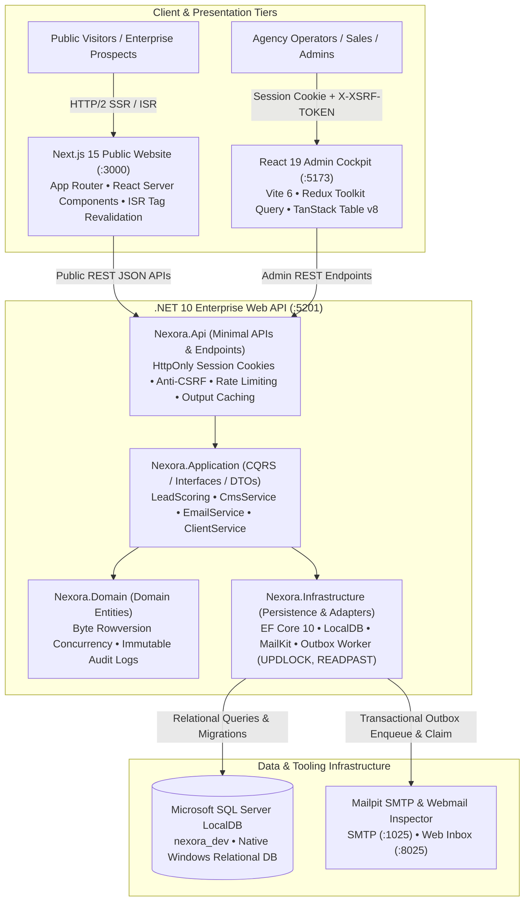

# Nexora Enterprise Digital Marketing & Agency Operations Platform

> **Classification:** Official Unified Master Platform Documentation & Engineering Runbook  
> **Platform Version:** 3.0 Production Core (Phase 1 Hardened)  
> **Repository:** `d:\Nexora-Digital-Marketing-Platform`  
> **Verification Status:** **209 / 209 Automated Tests Passing (100%)**, 0 Skipped, 0 Failures  
> **Quality Gate:** Strict TypeScript (`tsc`), ESLint, Semantic Token Color Audit, and Monorepo Tests clean (Exit Code 0)

---

## 1. Executive Summary & Business Mission

**Nexora** is an enterprise-grade digital marketing agency platform and operations SaaS. It combines a hyper-fast, high-converting public marketing website with an intuitive agency administration cockpit, backed by a resilient, event-driven .NET 10 backend engine and SQL Server.

### Core Business Objectives
- **Inbound Lead Generation:** Enterprise prospects discover services, calculate projected ROI, book discovery consultations, and submit briefs.
- **Agency Operations & CRM:** Inbound inquiries land in a real-time Kanban pipeline with automated corporate lead scoring (0–100), duplicate detection, and one-click conversion to active Client Accounts.
- **Dynamic Content & Theme Engine (Zero-Static Policy):** 100% of the website content—hero banners, capability features, reviews, case studies, pricing, navigation menus, and design tokens—is stored in the database and managed via the Admin Portal.
- **Multi-Country Support:** Native multi-region capabilities supporting **India (`IN`)** and the **United States (`US`)** via cookie-based region resolution (`nexora_region`), localized currencies (INR `₹` / USD `$`), E.164 phone formatting, and regional compliance (DPDP Act 2023, GDPR, CCPA).

---

## 2. Monorepo System Architecture



---

## 3. Technology Stack & Packages Matrix

| Tier / Workspace | Framework & Libraries | Installed Version | Strategic Purpose |
| :--- | :--- | :---: | :--- |
| **Backend Runtime** | **.NET 10 LTS SDK** (C# 13) | `10.0.403` | Asynchronous Minimal APIs, high throughput, low memory footprint |
| **Database Engine** | **Microsoft SQL Server LocalDB** | `2019 / 2022` | Native zero-Docker relational engine with ACID guarantees (no Redis required) |
| **ORM & Migrations**| **Entity Framework Core 10** | `10.0.14` | Code-first migrations, Byte Rowversion Concurrency (`[Timestamp]`), global filters |
| **Identity & Security** | **ASP.NET Core Identity** | `10.0.14` | Encrypted HttpOnly session cookies, PBKDF2 hashing, 12-char passwords, anti-CSRF |
| **Email Subsystem** | **MailKit + Transactional Outbox** | `4.18.2` | Atomic outbox claiming via `WITH (UPDLOCK, READPAST)`; zero email loss |
| **API Documentation** | **Scalar UI** | `2.0.18` | Modern interactive API playground at `/scalar/v1` (locked to Development) |
| **Public Website** | **Next.js 15 (App Router)** | `15.5.29` | Pure React Server Components (RSC), 100% static pre-rendered routes (47/47) via ISR |
| **Website Runtime** | **React 19** | `19.3.1` | Next-gen React actions, concurrent transitions, sub-second Core Web Vitals |
| **Admin Cockpit** | **React 19 + Vite 6** | `19.3.1` / `6.4.5` | Instant HMR development server, lightning-fast production Rollup builds |
| **Admin State & API**| **Redux Toolkit Query (RTK-Q)** | `2.14.0` | Cached queries, optimistic updates, automated `X-XSRF-TOKEN` cookie/header transport |
| **Data Tables** | **TanStack Table v8** | `8.21.3` | Fluid, sortable, paginated enterprise tables for leads and forensic audit logs |
| **Forms & Validation** | **Formik & Yup** | `2.4.6` / `1.7.1` | Strict client schemas, anti-bot honeypot, cryptographic time-trap tokens |
| **Internal Package** | `@nexora/design-tokens` | `workspace:*` | Semantic CSS variables compiler, WCAG 2.2 AA contrast checker, theme generator |
| **Internal Package** | `@nexora/contracts` | `workspace:*` | Shared TypeScript schemas and DTOs synchronized with C# models |
| **Dev Email Capture** | **Mailpit Standalone Binary** | `v1.33.1` | Local SMTP listener on port `1025` with real-time webmail inspector on port `8025` |

---

## 4. Key Platform Features & Modules

### 4.1 Inbound Lead Intake & Scoring Engine
Every inbound submission on `/contact`, `/book-a-call`, or modal triggers an automated pipeline:
1. **Anti-Bot Defense:** Invisible honeypot field (`website_hp`) silently drops automated scrapers; a cryptographic 3-second time-trap token prevents rapid robotic submissions.
2. **Automated Lead Scoring (`0–100 pts` evaluated in `LeadScoringService.cs`):**
   - Business/Corporate Domain Email (non-Gmail/Yahoo/Hotmail): `+25 pts`
   - Company Name Provided: `+15 pts`
   - Valid Regional Phone Number (length >= 7): `+15 pts`
   - Budget Tier Evaluation: up to `+25 pts` (Enterprise/25k+/50k: +25; Medium/10k: +15; Other: +5)
   - Urgency / Timeline Evaluation: up to `+20 pts` (Immediate/Urgent/< 1 month: +20; 1-3 months: +10; Other: +5)
   - *Total: Math.Clamp(score, 0, 100). Leads with score >= 60 are flagged as High-Priority SQL.*
   - Automated Duplicate Detection: Identifies recurring inquiries matching historical email/phone records.
3. **Transactional Outbox Emailing:** The database transaction simultaneously saves the lead and enqueues two outbox records:
   - Visitor auto-reply (`lead-auto-reply`) with personalized confirmation.
   - Internal sales alert (`lead-internal-notification`) dispatched to agency administrators.

### 4.2 Agency Administration Cockpit (`apps/admin`)
- **Dashboard:** Real-time KPI counters (Enterprise Accounts, Agency Staff, Inbound Inquiries, System Health Probes).
- **Leads Inbox (`/leads`):** Fluid 5-column Kanban board (`New Inquiry`, `Under Evaluation`, `Contacted`, `Qualified SQL`, `Converted / Closed`) + TanStack Table switcher, formula-injection escaped CSV export, and one-click "Convert to Client Account".
- **Clients & CRM (`/clients`):** Enterprise account management, corporate primary contacts, activity timeline notes, and task assignments.
- **Theme Studio (`/settings/theme-studio`):** Real-time interactive theme customizer with WCAG AA/AAA contrast telemetry and instant palette switching across 7 presets.
- **CMS Visual Page Builder (`/cms/pages` & `/cms/pages/:id/edit`):** Block manager supporting reordering, tone configuration (`light`, `alt`, `dark`, `brand-gradient`), animation levels, draft saving, live iframe preview, and atomic publishing.
- **Dedicated CMS Section Managers:** Granular control over `/cms/hero-banners`, `/cms/announcements`, `/cms/services`, `/cms/case-studies`, `/cms/testimonials`, and `/cms/faqs`.
- **Media Library (`/media`):** Central asset repository with magic-byte MIME validation, WebP conversion, and safe public media resolvers.
- **Navigation Menus (`/menus`):** Multi-level header and footer menu hierarchy editor.
- **Transactional Email Studio (`/emails`):** Template editor with merge variables (`{{lead.name}}`, `{{platform.companyName}}`), live HTML preview, test send triggers, and outbox delivery logs.
- **RBAC & Staff Governance (`/users`, `/roles`, `/audit-logs`):** Granular permission management across 4 core system roles (`Owner`, `Admin`, `Editor`, `Sales`) backed by an immutable SQL Server append-only audit trigger.

### 4.3 Public Marketing Portal (`apps/website`)
- **Zero-Static Policy:** CMS blocks (`StatsBlock`, `LogoStripBlock`, `TestimonialsBlock`, `CaseStudiesBlock`) render strictly from database content, returning `null` cleanly when empty to avoid synthetic placeholders.
- **Core Registered Block Types in `BlockRenderer.tsx`:**
  1. `HeroBlock`: Embla carousel, dual CTA buttons, theme-aware gradient overlays.
  2. `LogoStripBlock`: Infinite marquee of verified technologies and partner badges (renders null when empty).
  3. `StatsBlock`: Metric cards configured in database (renders null when empty).
  4. `FeatureGridBlock` & `BentoGridBlock`: High-intent growth capabilities with spotlight radial glow.
  5. `ChannelsGrowthDiagram`: Interactive omnichannel telemetry map linking channels to Nexora Engine.
  6. `TechEcosystemBlock`: Bidirectional scrolling enterprise marketing technology marquee.
  7. `ProcessSteps`: 4-phase execution framework (*Audit, Creatives & CRO, Launch, Scale*).
  8. `TestimonialsBlock`: 5-star verified client reviews with metric badges (renders null when empty).
  9. `CaseStudiesBlock`: Commercial case studies filtered by sector (renders null when empty).
  10. `BookingEmbed`: Strategic growth consultation calendar scheduling interface.
  11. `FaqBlock`: Accessible accordion with automated Google Rich Snippet `FAQPage` JSON-LD schema.
  12. `CtaBlock`: High-contrast conversion banner with primary diagnostic CTA.
  13. `RichTextBlock`: Long-form prose and editorial guidelines.
- **Pre-Seeded Routes:** Full dedicated pages for 12 Growth Services (`/services/seo`, `/services/paid-ads`, etc.), 8 Industry Sectors (`/industries/saas`, `/industries/ecommerce`, etc.), Blog Hub (`/blog/[slug]`), Legal Pages (`/privacy`, `/terms`, `/cookies`, `/accessibility`), and Consultation Booking (`/book-a-call`, `/free-audit`).

---

## 5. Theme & Design Tokens Library (`@nexora/design-tokens`)

The theme is an enterprise design token engine compiled into semantic CSS variables:

### The 7 System Presets
1. **Cyber Emerald & Deep Onyx (`cyber-emerald` - Default)**: Emerald `#10b981` | Cyan `#06b6d4` | Backdrop `#080c14` (Developer-first Linear/Cursor aesthetic).
2. **Modern Growth & Electric Violet (`modern-growth`)**: Violet `#8b5cf6` | Indigo `#6366f1` | Backdrop `#090714` (Modern generative aurora).
3. **Champagne Gold & Executive Obsidian (`champagne-gold`)**: Gold `#d4af37` | Champagne `#e5c158` | Backdrop `#0b0f17` (Luxury B2B, Private Equity).
4. **Silicon Valley Electric (`silicon-valley`)**: Electric Blue `#3b82f6` | Indigo `#6366f1` | Backdrop `#060b13` (Fintech Stripe/Ramp architecture).
5. **Monochrome Stealth & Laser Cobalt (`monochrome-stealth`)**: Pure White `#ffffff` | Sky `#38bdf8` | Backdrop `#000000` (Apple Pro OLED dark stealth).
6. **Sapphire Ocean & Cyber Cyan (`sapphire-ocean`)**: Ocean Blue `#0284c7` | Teal `#14b8a6` | Backdrop `#040d1a` (Cloud infrastructure aesthetic).
7. **Midnight Violet & Sunset Coral (`midnight-violet`)**: Violet `#7c3aed` | Coral `#f97316` | Backdrop `#07060f` (High-contrast creative).

---

## 6. RBAC Role & Permission Matrix

Permissions are evaluated per request against the user's role bindings:

| Permission Key | Owner | Admin | Editor | Sales | Scope & Description |
| :--- | :---: | :---: | :---: | :---: | :--- |
| `settings.view` / `settings.manage` | ✅ | ✅ | — | — | Enterprise branding, SMTP, regional configurations |
| `audit.view` | ✅ | ✅ | — | — | Append-only forensic security audit log |
| `users.view` | ✅ | ✅ | — | — | Inspect team member accounts and activity |
| `users.manage` | ✅ | — | — | — | Invite operators, suspend accounts, bind roles |
| `roles.view` | ✅ | ✅ | — | — | Read-only RBAC matrix inspection |
| `pages.view` / `pages.edit` | ✅ | ✅ | ✅ | — | Browse and modify CMS draft block schemas |
| `pages.publish` | ✅ | ✅ | — | — | Publish page drafts live to database & website |
| `leads.view` / `leads.manage` / `leads.export` | ✅ | ✅ | — | ✅ | Full Kanban pipeline, scoring, notes & CSV export |
| `clients.view` | ✅ | ✅ | — | ✅ | Access client accounts and CRM directory |
| `themes.view` / `themes.manage` | ✅ | ✅ | — | — | Modify design tokens, palettes, and active theme |

---

## 7. Step-by-Step Local Setup & Execution Guide

### 7.1 Prerequisites
- **Operating System:** Windows 10/11 (PowerShell 7+ recommended)
- **.NET SDK:** .NET 10.0 LTS installed (`dotnet --version`)
- **Node.js & Package Manager:** Node.js v20+ and pnpm v9+ (`npm i -g pnpm`)
- **SQL Server:** Native Microsoft SQL Server LocalDB (`(localdb)\MSSQLLocalDB`)

### 7.2 Service Port Reference
| Service | Local URL | Port | Default Credentials / Notes |
| :--- | :--- | :---: | :--- |
| **Public Website** | [http://localhost:3000](http://localhost:3000) | `3000` | Next.js 15 App Router |
| **Agency Admin** | [http://localhost:5173](http://localhost:5173) | `5173` | React 19 Agency Cockpit |
| **Backend Web API**| [http://localhost:5201](http://localhost:5201) | `5201` | ASP.NET Core 10 Web API |
| **Scalar API Docs** | [http://localhost:5201/scalar/v1](http://localhost:5201/scalar/v1) | `5201` | Interactive OpenAPI Playground |
| **Health Probes** | [http://localhost:5201/health/ready](http://localhost:5201/health/ready) | `5201` | Returns `HTTP 200 {"status":"Healthy"}` |
| **Mailpit Web UI** | [http://localhost:8025](http://localhost:8025) | `8025` | Real-time Webmail Inbox |
| **Mailpit SMTP** | `localhost:1025` | `1025` | Local SMTP listener for outbox worker |

### 7.3 One-Click Quickstart
```powershell
# 1. Install all monorepo dependencies
pnpm install

# 2. Launch Mailpit, Backend API, Website, and Admin simultaneously
./scripts/start-all.ps1
```

### 7.4 Manual Startup (Individual Terminals)
```powershell
# Terminal 1: Mailpit (Local SMTP)
./infra/tools/mailpit.exe

# Terminal 2: Backend API (.NET 10)
cd backend/src/Nexora.Api
dotnet run

# Terminal 3: Agency Admin (Vite SPA)
pnpm --filter @nexora/admin dev

# Terminal 4: Public Website (Next.js)
pnpm --filter @nexora/website dev
```

### 7.5 Seed Admin Access
Initial administrator access is seeded upon backend startup from environment variables:
- **URL:** `http://localhost:5173/login`
- **Email:** Value configured in `SEED_ADMIN_EMAIL` (`.env`)
- **Password:** Value configured in `SEED_ADMIN_PASSWORD` (`.env`, min 12 characters)
- **Role:** `Owner` (Full permissions)

---

## 8. Quality Gates & Monorepo Testing Suite

The repository is governed by strict automated quality gates. All **209 tests** run with **0 failures and 0 skipped**:

```powershell
# Run all quality checks across the entire monorepo:
pnpm check:all
# Executes:
# 1. pnpm run typecheck    (Strict TypeScript across contracts, admin, website)
# 2. pnpm run lint         (ESLint check across all frontend workspaces)
# 3. pnpm check:colors     (Semantic token audit scanner: 0 raw hex violations)
# 4. pnpm run test         (209 Unit, Architecture, and Integration tests)
```

### Test Suite Distribution
- **Backend Tests (xUnit + Shouldly + NetArchTest):** **142 passed**
  - `Nexora.UnitTests`: 37 passed (Domain rules, scoring engine, formatters)
  - `Nexora.ArchitectureTests`: 3 passed (Hexagonal boundaries and dependency rules)
  - `Nexora.IntegrationTests`: 102 passed (Identity, CSRF, Outbox, Cms, Leads, RBAC)
- **Admin Vitest Suite (React 19):** **46 passed** (Theme Studio, guards, navigation, formatters)
- **Website Vitest Suite (Next.js 15):** **21 passed** (BlockRenderer, UTM, A11y, Region, Primitives)

---

## 9. Monorepo Directory Organization

```
d:\Nexora-Digital-Marketing-Platform\
├── apps/
│   ├── admin/                    # React 19 + Vite 6 Agency Admin Cockpit
│   │   ├── src/
│   │   │   ├── components/       # Command palette, drawer, confirm dialogs
│   │   │   ├── layouts/          # Responsive admin shell with collapsible sidebar
│   │   │   ├── pages/            # Leads, CMS Pages, Clients, Emails, Roles, Settings
│   │   │   └── store/            # Redux Toolkit Query API slices
│   │   └── package.json
│   └── website/                  # Next.js 15 App Router Public Marketing Portal
│       ├── src/
│       │   ├── app/              # SSR/ISR pages (/, /services, /industries, /blog, /contact)
│       │   ├── components/       # BlockRenderer & 12 World-Class Marketing Block components
│       │   └── lib/              # CMS API fetchers, tracking scripts, region cookies
│       └── package.json
├── backend/                      # .NET 10 Solution (Hexagonal Architecture)
│   ├── src/
│   │   ├── Nexora.Api/           # Minimal APIs, Auth Cookies, Anti-CSRF, Caching, Endpoints
│   │   ├── Nexora.Application/   # CQRS, Domain Services, DTOs, FluentValidation
│   │   ├── Nexora.Domain/        # Domain Entities, Byte Rowversion Concurrency
│   │   ├── Nexora.Infrastructure/# EF Core 10, SQL Server LocalDB, MailKit, Outbox Processor
│   │   └── Nexora.Worker/        # Background processing worker host
│   └── tests/
│       ├── Nexora.UnitTests/     # 37 Unit Tests
│       ├── Nexora.ArchitectureTests/ # 3 Clean Architecture Enforcement Tests
│       └── Nexora.IntegrationTests/  # 102 Database Integration Tests
├── packages/
│   ├── contracts/                # Shared TypeScript contracts synced with C# DTOs
│   ├── design-tokens/            # Semantic CSS variables & 7 Theme Presets
│   ├── eslint-config/            # Shared monorepo ESLint rules
│   └── typescript-config/        # Strict shared tsconfig definitions
├── scripts/
│   ├── check-colors.mjs          # AST token scanner prohibiting raw hex colors
│   └── start-all.ps1             # PowerShell script launching all platform services
└── infra/
    └── tools/
        └── mailpit.exe           # Standalone local SMTP server & web inspector
```

---

## 10. Production Readiness & Known Roadmap Gaps

### P0 Launch Blockers (Go-Live Checklist)
1. **Real Content Population:** Replace remaining empty states with authenticated client testimonials, brand partner logos, and case studies.
2. **Backend Revalidation Webhook Trigger:** Wire backend publish event in `PageService` / `OutboxProcessor` to automatically dispatch `POST /api/revalidate?secret=...` to Next.js for instant cache invalidation upon publishing.
3. **Production Mailer Setup:** Switch SMTP configuration from local Mailpit to production transactional provider (AWS SES / Resend) with verified SPF, DKIM, and DMARC DNS records.
4. **HTML Sanitizer Hardening:** Upgrade regex-based `HtmlSanitizerHelper.cs` to robust AST library (`Ganss.Xss.HtmlSanitizer`) to prevent any potential mXSS bypasses.
5. **Admin Inserter Block Templates:** Expose `ChannelsGrowth` and `TechEcosystem` blocks inside Admin `PageEditorPage.tsx`'s `BLOCK_TEMPLATES` so operators can insert them into custom landing pages.
6. **Credential Rotation:** Rotate `SEED_ADMIN_PASSWORD` in `.env` and load production credentials via cloud key vaults or environment variables.

### P1/P2 Operations Enhancements
- **Admin Form Builder UI:** Add visual drag-and-drop web form builder in Admin to allow non-technical marketers to assemble custom inquiry forms.
- **Dedicated Tasks Kanban:** Expand the `/tasks` route into a standalone sales task manager with overdue date alerts and follow-up calendars.
- **Direct Lead Emailing:** Add quick-action modal in Leads Inbox to trigger templated outbound emails directly to prospective clients.
- **Outbound Webhooks:** Provide settings UI to dispatch webhook alerts (Slack, WhatsApp, CRM) upon lead intake.
