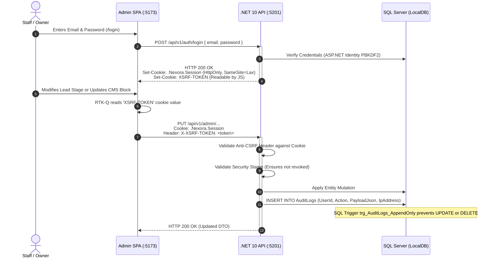

# Nexora Digital Marketing Platform

## Enterprise Master Architecture, Configuration & Operations Guide

> **Document Classification:** Single Unified Master Documentation & Execution Runbook  
> **Platform Version:** 3.0 (Production Core Multi-Tier SaaS — Phase 1 Hardened)  
> **Repository:** `d:\Nexora-Digital-Marketing-Platform`  
> **Verification Status:** **209 / 209 Automated Tests Passing (100%)**, 0 Skipped, 0 Failures  
> **Quality Gates:** `pnpm check:all` (Typecheck, ESLint, Design Tokens Color Audit, All Tests) passing cleanly

---

## 1. Executive Topology & Architecture Overview

Nexora is an enterprise-grade multi-tier digital marketing and agency operations SaaS built inside a unified monorepo. It couples an ultra-fast Next.js 15 public marketing portal with a high-productivity React 19 visual agency administration cockpit, driven by a resilient .NET 10 asynchronous backend and SQL Server.

```mermaid
flowchart TD
    subgraph ClientTiers["Client & Presentation Tiers"]
        WebProspect["Public Visitors / Enterprise Prospects"]
        StaffUser["Agency Operators / Platform Admins"]

        Website["Next.js 15 Public Website (:3000)<br/>App Router • React Server Components • ISR Tag Revalidation"]
        AdminSPA["React 19 Admin SPA (:5173)<br/>Vite • Redux Toolkit Query • Tailwind"]
    end

    subgraph BackendTier[".NET 10 Enterprise Web API (:5201)"]
        ApiLayer["Nexora.Api (Minimal APIs & Endpoints)<br/>HttpOnly Cookie Auth • Anti-CSRF • Rate Limiter • Output Caching"]
        AppLayer["Nexora.Application (CQRS / Interfaces / DTOs)<br/>CmsService • LeadService • ClientService • IdentityService"]
        DomainLayer["Nexora.Domain (Pure Business Logic)<br/>Entities • Concurrency Tokens • Immutable Audits"]
        InfraLayer["Nexora.Infrastructure (Persistence & Adapters)<br/>EF Core 10 • Identity • MailKit • Outbox Background Worker"]
    end

    subgraph DataTier["Data & Tooling Infrastructure"]
        SQLDB[("Microsoft SQL Server LocalDB<br/>nexora_dev • Byte Rowversion Concurrency")]
        MailpitTool["Mailpit SMTP & Webmail UI<br/>SMTP (:1025) • Web Inbox (:8025)"]
    end

    WebProspect -->|HTTP/2 SSR / ISR| Website
    Website -->|Public JSON APIs| ApiLayer
    StaffUser -->|Cookie Auth + Anti-CSRF| AdminSPA
    AdminSPA -->|Admin Endpoints| ApiLayer

    ApiLayer --> AppLayer --> DomainLayer
    AppLayer --> InfraLayer
    InfraLayer -->|Relational Queries| SQLDB
    InfraLayer -->|Transactional Outbox (UPDLOCK, READPAST)| MailpitTool
```

---

## 2. Verified Tech Stack Matrix

| Component               | Framework / Library                |  Installed Version  | Purpose & Strategic Rationale                                                                 |
| :---------------------- | :--------------------------------- | :-----------------: | :-------------------------------------------------------------------------------------------- |
| **Backend Runtime**     | **.NET 10 LTS SDK** (C# 13)        |     `10.0.403`      | High-throughput asynchronous Minimal APIs, type safety, low-memory footprint.                 |
| **Database Engine**     | **Microsoft SQL Server LocalDB**   |    `2019 / 2022`    | Zero-Docker native Windows relational database with ACID guarantees (no Redis dependency).    |
| **ORM & Migrations**    | **Entity Framework Core 10**       |      `10.0.14`      | Code-first schema migrations, Byte Rowversion Concurrency (`[Timestamp]`), query filters.     |
| **Identity & Security** | **ASP.NET Core Identity**          |      `10.0.14`      | Encrypted HttpOnly cookies, PBKDF2 hashing, 12-char min password, anti-CSRF header defense.   |
| **Caching & Comp.**     | **ASP.NET OutputCache + Comp.**    |      `net10.0`      | In-memory tag/endpoint output caching for public endpoints and Gzip/Brotli compression.       |
| **Email Subsystem**     | **MailKit + Transactional Outbox** |      `4.18.2`       | Atomic email scheduling with `WITH (UPDLOCK, READPAST)` worker claiming; zero email loss.     |
| **API Documentation**   | **Scalar UI (Dev-Only)**           |      `2.0.18`       | Interactive modern API playground at `/scalar/v1` (Swashbuckle Swagger removed).              |
| **Backend Testing**     | **xUnit + Shouldly + NetArchTest** |  `2.9.3` / `4.3.0`  | 142 backend tests: 37 unit tests + 3 architecture tests + 102 integration tests.              |
| **Public Website**      | **Next.js 15 (App Router)**        |      `15.5.29`      | React Server Components (RSC), 100% static pre-rendered routes (47/47) via ISR.              |
| **Agency Admin SPA**    | **React 19 + Vite 6**              | `19.3.1` / `6.4.5`  | Lightning-fast HMR, rich state, visual CMS studio, dynamic Kanban boards, 46 Vitest tests.    |
| **Admin State & API**   | **Redux Toolkit Query (RTK-Q)**    |      `2.14.0`       | Tag-based cache invalidation, optimistic updates, automatic `XSRF-TOKEN` header transport.   |
| **Data Tables**         | **TanStack Table v8**              |      `8.21.3`       | Fluid, sortable, paginated enterprise tables with multi-filter support.                       |
| **Styling & Tokens**    | **Tailwind CSS + PostCSS**         |      `3.4.19`       | Dark/Light semantic color tokens, fluid 24-inch widescreen layout scaling, audited tokens.   |
| **Micro-Interactions**  | **Pure CSS + Native Hooks**        |      `Native`       | CSS keyframe animations + lightweight hooks (`useReducedMotion`); zero motion-library bloat.  |
| **Monorepo Engine**     | **pnpm Workspaces**                |      `12.18.0`      | Shared TypeScript contracts (`@nexora/contracts`) and design tokens.                          |
| **Email Dev Capture**   | **Mailpit Standalone Binary**      |      `v1.33.1`      | Local SMTP listener on port `1025` with real-time webmail inspector on port `8025`.           |

---

## 3. End-to-End Architectural Flows

### 3.1 Inbound Lead Capture & Transactional Outbox Flow

```mermaid
sequenceDiagram
    autonumber
    actor Visitor as Enterprise Prospect
    participant Web as Next.js Website (:3000)
    participant API as .NET 10 API (:5201)
    participant DB as SQL Server (LocalDB)
    participant Worker as Outbox Background Processor
    participant Mail as Mailpit SMTP (:1025)

    Visitor->>Web: Fills Contact Form (/contact)
    Web->>Web: Verifies Honeypot & 3-sec Time-Trap Token
    Web->>API: POST /api/v1/public/forms/{formKey}/submissions (Anonymous, JSON)
    activate API
    API->>API: Validate Payload (FluentValidation)
    API->>DB: BEGIN TRANSACTION
    API->>DB: INSERT INTO Leads (Status: NewInquiry, Deduplication Check)
    API->>DB: INSERT INTO OutboxMessages (Event: LeadWelcomeEmail, Status: Pending)
    API->>DB: INSERT INTO OutboxMessages (Event: LeadInternalNotification, Status: Pending)
    API->>DB: COMMIT TRANSACTION
    API-->>Web: HTTP 201 Created { leadId, referenceNumber }
    deactivate API
    Web-->>Visitor: Displays Success Card with Reference ID

    loop Every 5 Seconds (Background Outbox Loop)
        Worker->>DB: BEGIN TRAN; SELECT TOP 10 * FROM Outbox WITH (UPDLOCK, READPAST); UPDATE SET Status = InProgress; COMMIT TRAN
        DB-->>Worker: Return Pending Messages
        Worker->>Worker: Render Razor/HTML Email Template with Merge Variables
        Worker->>Mail: SMTP Connect & Send (localhost:1025)
        Mail-->>Worker: 250 Message Accepted
        Worker->>DB: UPDATE OutboxMessages SET Status = 2 (Sent), ProcessedAtUtc = GETUTCDATE()
    end
```

### 3.2 Staff Authentication, Anti-CSRF & Immutable Audit Flow



---

## 4. Comprehensive Configuration Guide

### 4.1 Backend Configuration (.NET 10)

All backend configuration lives in `backend/src/Nexora.Api/appsettings.json` and can be overridden via environment variables:

```json
{
  "ConnectionStrings": {
    "DefaultConnection": "Server=(localdb)\\MSSQLLocalDB;Database=nexora_dev;Trusted_Connection=True;TrustServerCertificate=True"
  },
  "Cors": {
    "AllowedOrigins": ["http://localhost:5173", "http://localhost:3000"]
  },
  "Security": {
    "LockoutMaxFailedAccessAttempts": 5,
    "LockoutDefaultLockoutTimeSpanMinutes": 15,
    "RequireDigit": true,
    "RequireLowercase": true,
    "RequireUppercase": true,
    "RequireNonAlphanumeric": true,
    "RequiredLength": 12
  }
}
```

- **Cookie Auth Setup (`Program.cs`):**
  - Cookie Name: `.Nexora.Session` (configured via `AuthCookie:CookieName`)
  - `HttpOnly = true`, `SameSite = SameSiteMode.Lax`
  - Non-dev guard: Enforces `Secure = true` when `SameSite = None` and rejects wildcard CORS in production.
  - Returns `401 Unauthorized` / `403 Forbidden` JSON directly to SPA instead of redirecting.
- **Database Startup Seeder (`StartupSeeder.cs`):**
  - Executes EF Core migrations when `Database:ApplyMigrationsOnStartup` is true or running in `Development`.
  - Seeds primary `Owner` administrator strictly from `SEED_ADMIN_EMAIL` and `SEED_ADMIN_PASSWORD` env variables.
  - Seeds 4 System Roles: `Owner`, `Admin`, `Editor`, `Sales` with 16 granular permissions.
  - Seeds Dynamic Lookups: Pipeline stages (`Lead`, `Client`, `Deal`) and ISO Country Regions (`IN`, `US`, `AE`, `GB`, `SG`).
  - Purged of all synthetic/fabricated marketing claims ($240M+, 340%, fake client logos, fake reviews).
- **SQL Server Immutable Audit Trigger:**
  - Installs `trg_AuditLogs_AppendOnly` append-only database trigger (prohibits UPDATE and DELETE operations).
- **XSS Sanitization Helper (`HtmlSanitizerHelper.cs`):**
  - Server-side sanitizer strips `<script>`, `<iframe>`, `<object>`, `<embed>`, `<applet>`, inline JavaScript handlers (`on\w+=`), `javascript:`, and `data:text/html` from all incoming rich content before persisting.

---

### 4.2 Agency Admin SPA Configuration (React 19 + Vite)

Configured via `apps/admin/.env`:

```bash
VITE_API_URL=http://localhost:5201
VITE_WEBSITE_URL=http://localhost:3000
```

- **RTK Query Base API (`baseApi.ts`):**
  - Configured with `credentials: "include"` for transparent HttpOnly cookie transport.
  - Automatically extracts `XSRF-TOKEN` cookie and injects `X-XSRF-TOKEN` header on all mutation calls.
  - Provides tag-based cache invalidation (`Leads`, `Clients`, `Pages`, `Templates`, `Roles`, `Settings`).
- **Visual CMS Studio (`/cms/pages` & `/cms/pages/:id/edit`):**
  - Drag-and-drop block tree, component palette (`Hero`, `Stats`, `FeatureGrid`, `Testimonials`, `CTA`, `FAQ`), headline/content editors, and direct visibility toggles.
  - Live interactive `<iframe>` emulator with instant device viewport switching (`Desktop 1920px`, `Tablet 768px`, `Mobile 375px`).
- **Inbound Pipeline Kanban (`/leads`):**
  - 5 fluid columns: `New Inquiries`, `Under Evaluation`, `Contacted`, `Qualified SQL`, `Converted Client`.
  - One-click `Advance ➔` progression button on cards.
  - View switcher to TanStack paginated table mode.
  - Authenticated CSV export with formula injection escaping (sanitizes `=, +, -, @` prefixes).
  - Automatic deduplication detection against existing lead records.
  - One-click institutional conversion ("Promote to Client Account") creating client dossier, contacts, and initial records.
- **Phase 1 Exclusions:**
  - Tasks/project management, complex automation builders, and invoicing are out of scope for Phase 1. The legacy `/tasks` route cleanly redirects to `/clients`.
- **Transactional Email Studio (`/emails`):**
  - Split-screen HTML code editor and live sandbox preview envelope.
  - Click-to-insert variable merge pills (`{{lead.name}}`, `{{lead.company}}`, `{{platform.companyName}}`).
  - Real-time test dispatch button directly to Mailpit.
- **Roles & Permissions Matrix (`/roles`):**
  - Full CRUD for custom roles across 7 security domains with protected system roles (`Owner`, `Admin`).

---

### 4.3 Public Website Configuration (Next.js 15 App Router)

Configured in `apps/website`:

- **Static Pre-Rendering (ISR):**
  - All 47 public routes are statically pre-rendered at build time with tag-based revalidation (`next: { revalidate: 3600, tags: [...] }`).
  - Server components are pure RSC without blocking cookies/headers calls.
- **Honesty & Conditional Rendering:**
  - Empty CMS blocks (`StatsBlock`, `LogoStripBlock`, `TestimonialsBlock`, `CaseStudiesBlock`) cleanly return `null` when no published DB records exist. No empty shell or synthetic mock data is rendered.
- **Real 404 Pages:**
  - Unknown routes trigger real 404 HTTP status (`notFound()`), eliminating the legacy static fallback behavior.
- **Anti-Bot Defense (`ContactForm.tsx` & `BookingEmbed.tsx`):**
  - Invisible honeypot field (`website_hp`) silently drops automated scrapers.
  - Cryptographic 3-second time-trap token prevents rapid robotic submissions.
  - Explicit DPDP/GDPR consent capture with audit timestamp metadata.
- **Consent-Gated Analytics & Tracking (`TrackingScripts.tsx`):**
  - Third-party tracking scripts (GTM, GA4, Meta Pixel, Microsoft Clarity, LinkedIn Insight Tag) are loaded strictly AFTER explicit user consent in the `CookieBanner`.
  - Fires consent-checked events (`nexora_lead_submit`, `nexora_cta_click`, `nexora_contact_click`) to `window.dataLayer`.
- **Security Headers (`next.config.ts`):**
  - Strict-Transport-Security (HSTS), X-Content-Type-Options: `nosniff`, Referrer-Policy: `strict-origin-when-cross-origin`, Permissions-Policy, and configurable `frame-ancestors` allowing Admin preview while blocking clickjacking.

---

## 5. Theme & Motion System

### 5.1 Color Tokens & Design System

- **Strategy:** Semantic CSS custom variables driven by `packages/design-tokens` with Tailwind integration.
- **Theme Palette:** 6 curated presets (Cyber Emerald, Silicon Valley Electric, Tokyo Neon, Nordic Minimal, Copper Heritage, Obsidian Luxury).
- **Audit Gate:** Verified via `pnpm check:colors` — 0 violations across all scanned components.

### 5.2 Motion & Animation Principles

- **Performance-First:** Animations animate exclusively `transform` and `opacity` (plus `clip-path` for image reveals). No layout shifts (CLS ≈ 0).
- **Reduced Motion:** Global `@media (prefers-reduced-motion: reduce)` and `[data-animation-mode="off"]` overrides disable movement/marquee/parallax; keep instant opacity changes.
- **Consistent Tokens:** Durations 150/250/500/700ms, easing `cubic-bezier(0.22, 1, 0.36, 1)`.

---

## 6. How to Run & Operate the Platform

### 6.1 Service Port Map

| Service             | Local URL                                                                |  Port  | Purpose                                   |
| :------------------ | :----------------------------------------------------------------------- | :----: | :---------------------------------------- |
| **Public Website**  | [http://localhost:3000](http://localhost:3000)                           | `3000` | Next.js 15 Marketing Portal (Prod/Dev)    |
| **Agency Admin**    | [http://localhost:5173](http://localhost:5173)                           | `5173` | React 19 Agency Operations Cockpit (Vite) |
| **Backend API**     | [http://localhost:5201](http://localhost:5201)                           | `5201` | ASP.NET Core 10 Web API                   |
| **Scalar API Docs** | [http://localhost:5201/scalar/v1](http://localhost:5201/scalar/v1)       | `5201` | Interactive API Playground (Dev Only)     |
| **Health Probes**   | [http://localhost:5201/health/ready](http://localhost:5201/health/ready) | `5201` | Database Readiness Check                  |
| **Mailpit Web UI**  | [http://localhost:8025](http://localhost:8025)                           | `8025` | Real-time Email Inspector & Webmail       |
| **Mailpit SMTP**    | `localhost:1025`                                                         | `1025` | Local SMTP Mail Capture                   |
| **SQL Server**      | `(localdb)\MSSQLLocalDB`                                                 | Native | LocalDB Instance (`nexora_dev`)           |

---

### 6.2 Administrator Credentials Configuration

Initial platform owner credentials are read strictly from environment variables or `.env`:

| Field              | Configuration Key             | Notes                                            |
| :----------------- | :---------------------------- | :----------------------------------------------- |
| **Admin Portal**   | `http://localhost:5173/login` | Agency Admin Login Page                          |
| **Admin Email**    | `SEED_ADMIN_EMAIL`            | Set in `.env` / user-secrets                     |
| **Admin Password** | `SEED_ADMIN_PASSWORD`         | Set in `.env` (min 12 chars per policy)          |
| **Assigned Role**  | `Owner`                       | Unrestricted 16/16 administrative permissions    |
| **First Login**    | `MustChangePassword`          | Forced password rotation required on first login |

---

### 6.3 Monorepo Command Suite

```powershell
# Run the complete test & quality gate across all workspaces:
pnpm check:all       # Runs typecheck + lint + check:colors + all vitest & dotnet tests

# Individual quality gates:
pnpm run typecheck   # Strict TypeScript check across contracts, admin, and website
pnpm run lint        # ESLint check
pnpm check:colors    # Design token compliance audit
pnpm run test        # Runs frontend Vitest and backend dotnet test suites

# Build commands:
pnpm --filter @nexora/admin build     # Production Vite build
pnpm --filter @nexora/website build   # Production Next.js 15 static ISR build
dotnet build backend/Nexora.sln       # Backend .NET 10 compilation
```

---

### 6.4 Automated Test Suite Breakdown

All **209 automated tests** pass with **0 failures** and **0 skipped**:

```powershell
# 1. Backend Tests (.NET 10 xUnit + Shouldly + NetArchTest)
dotnet test backend/Nexora.sln
# Nexora.UnitTests:        37 passed (Domain entities, validation, services)
# Nexora.ArchitectureTests: 3 passed (Hexagonal boundaries, dependency rules)
# Nexora.IntegrationTests: 102 passed (API endpoints, Auth, CSRF, Outbox, Cms, Leads)
# Subtotal: 142 passed

# 2. Agency Admin Vitest Suite (React 19)
pnpm --filter @nexora/admin test
# Subtotal: 46 passed (Theme studio, navigation, auth guards, utility formatters)

# 3. Public Website Vitest Suite (Next.js 15)
pnpm --filter @nexora/website test
# Subtotal: 21 passed (BlockRenderer, Navigation, A11y, Primitives, UTM, Region)

# GRAND TOTAL: 209 PASSED (100%)
```

---

## 7. Monorepo Directory Structure

```
d:\Nexora-Digital-Marketing-Platform\
├── apps/
│   ├── admin/                    # React 19 + Vite Agency Admin Cockpit
│   │   ├── src/
│   │   │   ├── components/       # UI primitives, Kanban boards, layouts
│   │   │   ├── pages/            # Leads, CMS Studio, Clients, Emails, Roles, Settings
│   │   │   └── store/            # Redux Toolkit Query API clients
│   │   └── package.json
│   └── website/                  # Next.js 15 (App Router) Public Marketing Portal
│       ├── src/
│       │   ├── app/              # RSC routes (/, /services, /industries, /blog, /contact)
│       │   ├── components/       # Dynamic block renderer & block components
│       │   └── lib/              # CMS API clients, tracking, region config
│       └── package.json
├── backend/                      # .NET 10 Solution (Hexagonal Clean Architecture)
│   ├── src/
│   │   ├── Nexora.Api/           # Minimal APIs, Auth Cookies, Anti-CSRF, Caching, Endpoints
│   │   ├── Nexora.Application/   # CQRS, Domain Services, DTOs, FluentValidation
│   │   ├── Nexora.Domain/        # Pure Domain Entities, Byte Rowversion Concurrency
│   │   ├── Nexora.Infrastructure/# EF Core 10, SQL Server, MailKit, Outbox Processor, Sanitizer
│   │   └── Nexora.Worker/        # Standalone Background Service Host
│   └── tests/
│       ├── Nexora.UnitTests/     # 37 Unit Tests
│       ├── Nexora.ArchitectureTests/ # 3 Strict Hexagonal Architecture Tests
│       └── Nexora.IntegrationTests/  # 102 Database Integration Tests
├── packages/
│   ├── contracts/                # Shared TypeScript contracts synced with C# DTOs
│   ├── design-tokens/            # Semantic CSS design variables & Tailwind tokens
│   ├── eslint-config/            # Shared ESLint configuration
│   └── typescript-config/        # Shared tsconfig definitions
├── scripts/
│   ├── check-colors.mjs          # Semantic token audit scanner
│   └── start-all.ps1             # One-click PowerShell orchestrator for all services
└── infra/
    └── tools/
        └── mailpit.exe           # Standalone local SMTP binary (ports 1025 / 8025)
```
