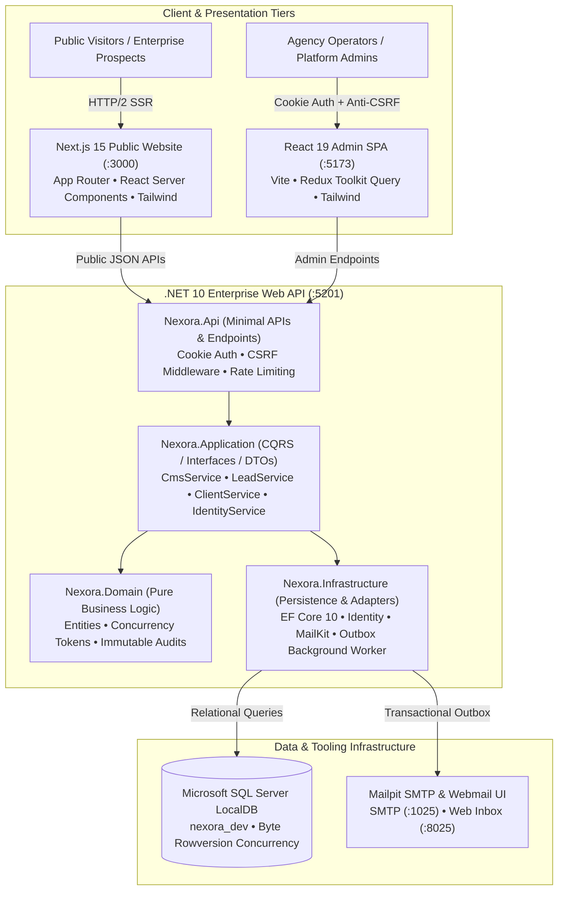
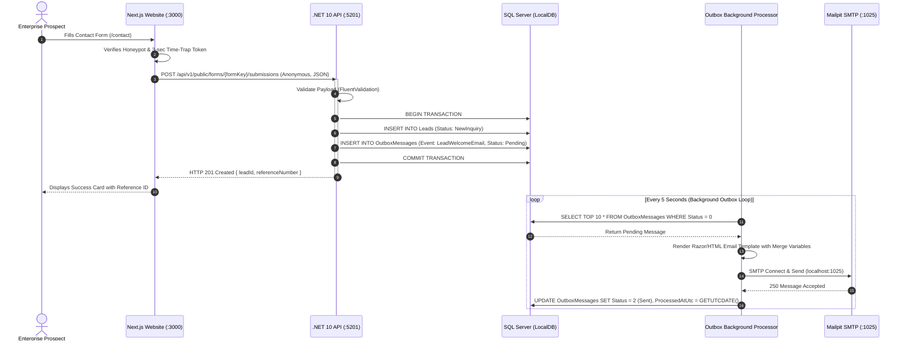
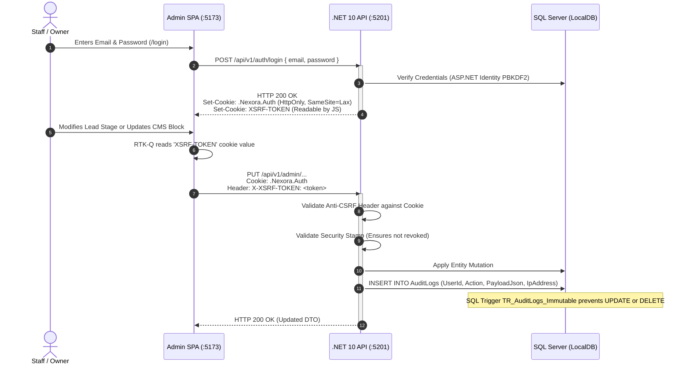

# Nexora Digital Marketing Platform

## Enterprise Master Architecture, Configuration & Operations Guide

> **Document Classification:** Single Unified Master Documentation & Execution Runbook  
> **Platform Version:** 3.0 (Production Core Multi-Tier SaaS)  
> **Repository:** `d:\Nexora-Digital-Marketing-Platform`  
> **Verification Status:** **75 / 75 Automated Tests Passing (100%)**, 0 Skipped, 0 Failures

---

## 1. Executive Topology & Architecture Overview

Nexora is an enterprise-grade multi-tier digital marketing and agency operations SaaS built inside a unified monorepo. It couples an ultra-fast Next.js 15 public marketing portal with a high-productivity React 19 visual agency administration cockpit, driven by a resilient .NET 10 asynchronous backend and SQL Server.



---

## 2. Verified Tech Stack Matrix

| Component               | Framework / Library                |  Installed Version  | Purpose & Strategic Rationale                                                             |
| :---------------------- | :--------------------------------- | :-----------------: | :---------------------------------------------------------------------------------------- |
| **Backend Runtime**     | **.NET 10 LTS SDK** (C# 13)        |     `10.0.403`      | High-throughput asynchronous Minimal APIs, type safety, low-memory footprint.             |
| **Database Engine**     | **Microsoft SQL Server LocalDB**   |    `2019 / 2022`    | Zero-Docker native Windows relational database with ACID guarantees.                      |
| **ORM & Migrations**    | **Entity Framework Core 10**       |      `10.0.14`      | Code-first schema migrations, Byte Rowversion Concurrency (`[Timestamp]`), query filters. |
| **Identity & Security** | **ASP.NET Core Identity**          |      `10.0.14`      | Encrypted HttpOnly cookies, PBKDF2 hashing, lockout defense, security stamp revocation.   |
| **Email Subsystem**     | **MailKit + Transactional Outbox** |      `4.18.2`       | Resilient, atomic email scheduling; background hosted worker ensures zero email loss.     |
| **API Documentation**   | **Scalar UI + Swagger UI**         | `2.0.18` / `10.3.1` | Rich interactive modern API playground at `/scalar/v1` and `/swagger`.                    |
| **Backend Testing**     | **xUnit + Shouldly + NetArchTest** |  `2.9.3` / `4.3.0`  | Comprehensive unit, integration, and strict hexagonal architecture verification.          |
| **Public Website**      | **Next.js 15 (App Router)**        |      `15.5.29`      | React Server Components (RSC) for zero-client-JS marketing pages and edge SEO.            |
| **Agency Admin SPA**    | **React 19 + Vite 6**              | `19.3.1` / `6.4.5`  | Lightning-fast HMR, rich state, visual CMS split-screen studio, dynamic Kanban boards.    |
| **Admin State & API**   | **Redux Toolkit Query (RTK-Q)**    |      `2.14.0`       | Tag-based cache invalidation, optimistic updates, automatic `XSRF-TOKEN` transport.       |
| **Data Tables**         | **TanStack Table v8**              |      `8.21.3`       | Fluid, sortable, paginated enterprise tables with multi-filter support.                   |
| **Styling & Tokens**    | **Tailwind CSS + PostCSS**         |      `3.4.19`       | Dark/Light semantic color tokens, fluid 24-inch widescreen layout scaling.                |
| **Monorepo Engine**     | **pnpm Workspaces**                |      `12.18.0`      | Shared TypeScript contracts (`@nexora/contracts`) and design tokens.                      |
| **Email Dev Capture**   | **Mailpit Standalone Binary**      |      `v1.33.1`      | Local SMTP listener on port `1025` with real-time webmail inspector on port `8025`.       |

---

## 3. End-to-End Architectural Flows

### 3.1 Inbound Lead Capture & Transactional Outbox Flow



### 3.2 Staff Authentication, Anti-CSRF & Immutable Audit Flow



---

## 4. Comprehensive Configuration Guide (All Over)

### 4.1 Backend Configuration (.NET 10)

All backend configuration lives in `backend/src/Nexora.Api/appsettings.json` and can be overridden via environment variables:

```json
{
  "ConnectionStrings": {
    "DefaultConnection": "Server=(localdb)\\MSSQLLocalDB;Database=nexora_dev;Trusted_Connection=True;TrustServerCertificate=True"
  },
  "Cors": {
    "AllowedOrigins": ["http://localhost:5173", "http://localhost:3000"]
  },
  "Security": {
    "LockoutMaxFailedAccessAttempts": 5,
    "LockoutDefaultLockoutTimeSpanMinutes": 15,
    "RequireDigit": true,
    "RequireLowercase": true,
    "RequireUppercase": true,
    "RequireNonAlphanumeric": true,
    "RequiredLength": 8
  }
}
```

- **Cookie Auth Setup (`Program.cs`):**
  - Cookie Name: `.Nexora.Session` (configured via `AuthCookie:CookieName`)
  - `HttpOnly = true`, `SameSite = SameSiteMode.Lax`
  - Returns `401 Unauthorized` / `403 Forbidden` JSON directly to SPA instead of redirecting.
- **Database Startup Seeder (`StartupSeeder.cs`):**
  - Executes EF Core migrations when running under `Development` environment.
  - Seeds primary `Owner` administrator strictly from `SEED_ADMIN_EMAIL` and `SEED_ADMIN_PASSWORD` env variables.
  - Seeds 4 System Roles: `Owner`, `Admin`, `Editor`, `Sales` with 16 granular permissions.
  - Seeds Dynamic Lookups: Pipeline stages (`Lead`, `Client`, `Deal`) and ISO Country Regions (`IN`, `US`, `AE`, `GB`, `SG`).
  - Seeds Default Published Home Page with dynamic block array (`Hero`, `Stats`, `FeatureGrid`, `CTA`, `FAQ`).
  - Seeds Default Transactional Email Templates.
- **SQL Server Immutable Audit Trigger:**
  - Installs `trg_AuditLogs_AppendOnly` append-only database trigger (prohibits UPDATE and DELETE operations).

---

### 4.2 Agency Admin SPA Configuration (React 19 + Vite)

Configured via `apps/admin/.env`:

```bash
VITE_API_URL=http://localhost:5201
VITE_WEBSITE_URL=http://localhost:3000
```

- **RTK Query Base API (`baseApi.ts`):**
  - Configured with `credentials: "include"` for transparent HttpOnly cookie transport.
  - Automatically extracts `XSRF-TOKEN` cookie and injects `X-XSRF-TOKEN` header on all mutation calls.
  - Provides tag-based cache invalidation (`Leads`, `Clients`, `Tasks`, `Pages`, `Templates`, `Roles`, `Settings`).
- **Visual CMS Studio (`/cms/pages` & `/cms/pages/:id/edit`):**
  - **Left Panel:** Drag-and-drop block tree, component palette (`Hero`, `Stats`, `FeatureGrid`, `Testimonials`, `Pricing`, `CTA`, `FAQ`), headline/content editors, and **direct ON/OFF visibility switches** on every section.
  - **Right Panel:** Live interactive `<iframe>` emulator with instant device viewport switching (`Desktop 1920px`, `Tablet 768px`, `Mobile 375px`).
- **Inbound Pipeline Kanban (`/leads`):**
  - 5 fluid columns: `New Inquiries`, `Under Evaluation`, `Contacted`, `Qualified SQL`, `Converted Client`.
  - One-click `Advance ➔` progression button on cards.
  - View switcher to paginated table mode.
  - Authenticated binary blob CSV export with cookie preservation.
  - One-click institutional conversion ("Promote to Client Account") creating client dossier, contacts, and onboarding tasks.
- **Operations Delivery Kanban (`/tasks`):**
  - 3 delivery columns: `Pending & Backlog`, `In Progress`, `Completed Deliverables`.
  - Automated overdue warning alerts (`⚠ Overdue`) and color-coded priority badges.
- **Transactional Email Studio (`/emails`):**
  - Split-screen HTML code editor and live sandbox preview envelope.
  - Click-to-insert variable merge pills (`{{lead.name}}`, `{{lead.company}}`, `{{platform.companyName}}`).
  - Real-time test dispatch button directly to Mailpit.
- **Roles & Permissions Matrix (`/roles`):**
  - Full CRUD for custom roles across 7 security domains with protected system roles (`Owner`, `Admin`).

---

### 4.3 Public Website Configuration (Next.js 15 App Router)

Configured in `apps/website`:

- **Dynamic Block Renderer Engine (`BlockRenderer.tsx`):**
  - Renders blocks received from backend CMS JSON: `HeroBlock`, `StatsBlock`, `FeatureGridBlock`, `TestimonialsBlock` (5-star ratings & reviews), `PricingBlock` (Monthly/Annual toggle with -20% badge), `CtaBlock`, `FaqBlock`.
- **Zero-404 Fallback Routing (`[...slug]/page.tsx`):**
  - Automatically provides rich default fallback structures for `/solutions`, `/about`, `/blog`, `/contact` so primary navigation links never 404 even before admin publishes customized blocks.
- **Anti-Bot Defense (`ContactForm.tsx`):**
  - Invisible honeypot field (`website_hp`) silently drops scrapers.
  - Cryptographic 3-second time-trap token prevents rapid robotic automated spam.
  - Captures explicit DPDP/GDPR consent with audit metadata.
- **Iframe Embedding Security (`next.config.ts`):**
  - Configures `Content-Security-Policy: frame-ancestors 'self' http://localhost:5173 http://localhost:3000 http://localhost:5201;` to allow seamless visual preview inside Admin SPA without browser blocking.

---

## 5. Theme & Ultra-Wide Design System

### 5.1 Color Tokens & Dark/Light Mode

Configured in `apps/admin/tailwind.config.ts` and `apps/website/tailwind.config.ts`:

- **Theme Strategy:** `darkMode: "class"`. Toggling adds or removes the `dark` class on the root `<html>` element.
- **Design Tokens:**
  - **Brand Accent:** Indigo-to-Violet gradient (`#4f46e5` to `#7c3aed`).
  - **Dark Surface:** Deep obsidian `#070b14` (Page), `#0c1222` (Card), `#1e293b` (Border).
  - **Light Surface:** Clean slate `#f8fafc` (Page), `#ffffff` (Card), `#e2e8f0` (Border).
  - **Semantic Accents:** Emerald (`#10b981`), Amber (`#f59e0b`), Rose (`#f43f5e`), Sky (`#0284c7`).

### 5.2 24-Inch Monitor Fluid Scaling

- Containers configured for ultra-wide viewports: `max-w-[1720px] 2xl:max-w-[1920px]`.
- Dynamic responsive padding: `px-6 sm:px-10 lg:px-12 xl:px-16`.
- Grids scale up to 5 columns on `1920px+` monitors with zero narrow side gutters.

---

## 6. How to Run & Operate the Platform

### 6.1 Service Port Map

| Service             | Local URL                                                                |  Port  | Purpose                             |
| :------------------ | :----------------------------------------------------------------------- | :----: | :---------------------------------- |
| **Public Website**  | [http://localhost:3000](http://localhost:3000)                           | `3000` | Next.js 15 Marketing Portal         |
| **Agency Admin**    | [http://localhost:5173](http://localhost:5173)                           | `5173` | React 19 Agency Operations Cockpit  |
| **Backend API**     | [http://localhost:5201](http://localhost:5201)                           | `5201` | ASP.NET Core 10 Web API             |
| **Scalar API Docs** | [http://localhost:5201/scalar/v1](http://localhost:5201/scalar/v1)       | `5201` | Modern Interactive API Playground   |
| **Swagger UI**      | [http://localhost:5201/swagger](http://localhost:5201/swagger)           | `5201` | Traditional OpenAPI Schema Explorer |
| **Health Probes**   | [http://localhost:5201/health/ready](http://localhost:5201/health/ready) | `5201` | Database Readiness Check            |
| **Mailpit Web UI**  | [http://localhost:8025](http://localhost:8025)                           | `8025` | Real-time Email Inspector & Webmail |
| **Mailpit SMTP**    | `localhost:1025`                                                         | `1025` | Local SMTP Mail Capture             |
| **SQL Server**      | `(localdb)\MSSQLLocalDB`                                                 | Native | LocalDB Instance (`nexora_dev`)     |

---

### 6.2 Administrator Credentials Configuration

Initial platform owner credentials are never hardcoded. They are read strictly from environment variables or `.env`:

| Field              | Configuration Key             | Notes                                            |
| :----------------- | :---------------------------- | :----------------------------------------------- |
| **Admin Portal**   | `http://localhost:5173/login` | Agency Admin Login Page                          |
| **Admin Email**    | `SEED_ADMIN_EMAIL`            | Set in `.env` / user-secrets                     |
| **Admin Password** | `SEED_ADMIN_PASSWORD`         | Set in `.env` (min 12 chars per policy)          |
| **Assigned Role**  | `Owner`                       | Unrestricted 16/16 administrative permissions    |
| **First Login**    | `MustChangePassword`          | Forced password rotation required on first login |

---

### 6.3 One-Click Startup (Single PowerShell Command)

To boot the entire platform (all 4 services) simultaneously:

```powershell
cd d:\Nexora-Digital-Marketing-Platform
.\scripts\start-all.ps1
```

Or start individual services manually in separate terminals:

```powershell
# 1. Start Mailpit (SMTP on 1025, Web UI on 8025)
& "infra\tools\mailpit.exe" -s [::]:1025 -l [::]:8025

# 2. Start Backend API (Port 5201)
dotnet run --project backend\src\Nexora.Api --urls "http://localhost:5201"

# 3. Start Public Website (Port 3000)
pnpm --prefix apps/website run dev

# 4. Start Admin SPA (Port 5173)
pnpm --prefix apps/admin run dev
```

---

### 6.4 Verification Suite & Automated Tests

All automated tests across backend and frontend are passing with **0 skipped** and **0 failures**:

```powershell
# 1. Execute all 62 Backend Tests (.NET 10)
dotnet test backend\Nexora.sln --logger "console;verbosity=minimal"
# Result: Passed! - Failed: 0, Passed: 62, Skipped: 0, Total: 62

# 2. Execute Admin SPA Vitest Suite (React 19)
npm --prefix apps/admin run test
# Result: 6 passed (6)

# 3. Execute Website Vitest Suite (Next.js 15)
npm --prefix apps/website run test
# Result: 7 passed (7)

# 4. Production Build Verification
npm --prefix apps/admin run build    # Vite production bundle clean
npm --prefix apps/website run build  # Next.js 15 SSR bundle clean (11/11 routes)
```

---

## 7. Monorepo Directory Structure

```
d:\Nexora-Digital-Marketing-Platform\
├── apps/
│   ├── admin/                    # React 19 + Vite Agency Admin Cockpit
│   │   ├── src/
│   │   │   ├── components/       # UI primitives, Kanban boards, layouts
│   │   │   ├── pages/            # Leads, CMS Studio, Tasks, Emails, Roles, Settings
│   │   │   └── store/            # Redux Toolkit Query API clients
│   └── website/                  # Next.js 15 (App Router) Public Marketing Portal
│       ├── src/
│       │   ├── app/              # RSC routes (/, /solutions, /about, /blog, /contact)
│       │   └── components/       # Dynamic block renderer & block components
├── backend/                      # .NET 10 Solution (Hexagonal Clean Architecture)
│   ├── src/
│   │   ├── Nexora.Api/           # Minimal APIs, Auth Cookies, Anti-CSRF, Endpoints
│   │   ├── Nexora.Application/   # CQRS, Domain Services, DTOs, FluentValidation
│   │   ├── Nexora.Domain/        # Pure Domain Entities, Byte Rowversion Concurrency
│   │   └── Nexora.Infrastructure/# EF Core 10, SQL Server, MailKit, Outbox Processor
│   └── tests/
│       ├── Nexora.UnitTests/
│       ├── Nexora.ArchitectureTests/
│       └── Nexora.IntegrationTests/
├── packages/
│   ├── contracts/                # Shared TypeScript contracts synced with C# DTOs
│   ├── design-tokens/            # Semantic CSS design variables & Tailwind tokens
│   ├── eslint-config/            # Shared ESLint configuration
│   └── typescript-config/        # Shared tsconfig definitions
├── scripts/
│   └── start-all.ps1             # One-click PowerShell orchestrator for all services
└── infra/
    └── tools/
        └── mailpit.exe           # Standalone local SMTP binary (ports 1025 / 8025)
```
