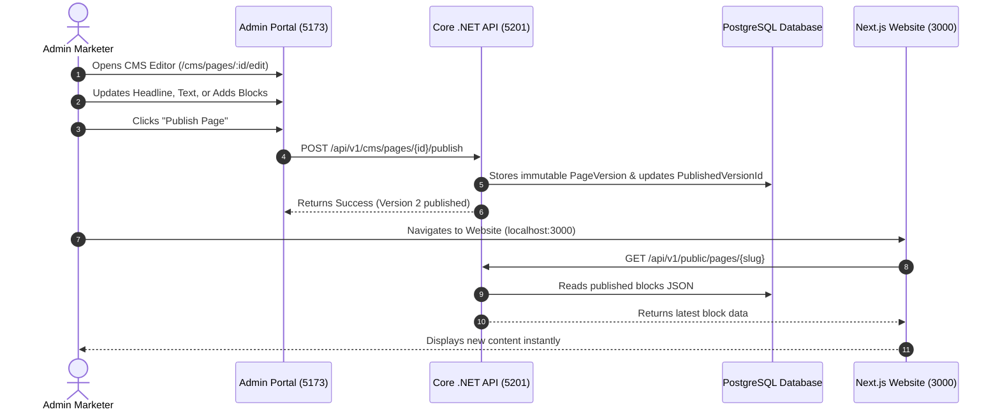

# Nexora Digital Platform — Website Master Content, Library & Tech Stack Documentation

> **Platform:** Nexora Enterprise Digital Marketing Platform  
> **Target Audience:** Developers, Content Editors, Agency Administrators, Marketing Directors  
> **Last Updated:** November 2026 (Nexora v2.0 Production Ready)  

---

## 1. Complete Technology Stack & Libraries

### A. Public Website (`apps/website`)
| Category | Technology / Library | Version / Details | Purpose in Website |
| :--- | :--- | :--- | :--- |
| **Framework** | **Next.js** | `^15.2.0` (App Router) | High-speed SSR, SSG, dynamic server components, dynamic SEO meta, streaming layout |
| **UI Runtime** | **React** | `^19.0.0` | Modern React 19 architecture with Actions and transitions |
| **Language** | **TypeScript** | `^5.7.0` | Strict type safety across CMS blocks, theme tokens, and API requests |
| **Styling** | **Tailwind CSS** | `^3.4.1` | Utility-first responsive styling with custom CSS variable mapping |
| **Typography Plugin** | `@tailwindcss/typography` | `^0.5.16` | Prose styles for long-form blog articles, rich text, and case studies |
| **Icon System** | **Lucide React** | `^1.16.0` | Modern feather icon suite (over 1,000+ vector SVG icons) |
| **CSS Utilities** | `clsx` & `tailwind-merge` | `^2.1.1` & `^3.0.2` | Conditional class joining without CSS selector conflicts |
| **Phone & Country** | `libphonenumber-js` & `i18n-iso-countries` | `^1.11.20` & `^7.14.0` | Global phone validation, country flags, and dynamic currency/tax labels |
| **Internal Package** | `@nexora/design-tokens` | `workspace:*` | Custom token compiler, WCAG contrast checking, dynamic theme-to-CSS generator |
| **Internal Package** | `@nexora/contracts` | `workspace:*` | Shared TypeScript schemas and DTOs between backend and frontend |

### B. Admin Portal (`apps/admin`)
| Category | Technology / Library | Purpose in Admin |
| :--- | :--- | :--- |
| **Build Tool** | **Vite** `v6.4.5` | Instant HMR development server and ultra-fast Rollup production builds |
| **State & API Cache** | **Redux Toolkit & RTK Query** | Cached API queries, automatic tag invalidation, optimistic updates |
| **Routing** | **React Router DOM** `v7.x` | Client-side routing with role-based and permission-based route guards |
| **Form Handling** | **Formik & Yup** | Robust validation schemas for CMS blocks, theme inputs, and site settings |
| **Data Tables** | `@tanstack/react-table` `v8.x` | Server-paginated, sortable, and filterable tables for Leads and Audit logs |

### C. Backend Engine (`backend`)
| Category | Technology / Library | Details |
| :--- | :--- | :--- |
| **Runtime** | **.NET 10.0** (C# 14) | High-performance Minimal APIs running on Kestrel HTTP/2 |
| **ORM & Database** | **Entity Framework Core 10** + **PostgreSQL** | Strict relational schema, version token concurrency, and spatial data |
| **Caching Layer** | **Redis** (`StackExchange.Redis`) | Sub-millisecond public theme and navigation menu caching |
| **Security & Auth** | **ASP.NET Core Identity** + JWT + BCrypt | Granular permission claims (`themes.manage`, `cms.pages.publish`, etc.) |

---

## 2. Theme & Design Tokens Library (`@nexora/design-tokens`)

The theme is **not a static template**. It is an enterprise design token engine.

### The 6 Seeded System Presets
1. **Cyber Emerald & Deep Onyx (`cyber-emerald` - Default)**
   - Primary: `#10b981` (Emerald) | Accent: `#06b6d4` (Cyan) | Backdrop: `#080c14` (Deep Navy)
   - Style: Supabase, Linear & Cursor developer-first aesthetic.
2. **Champagne Gold & Executive Obsidian (`champagne-gold`)**
   - Primary: `#d4af37` (Gold) | Accent: `#e5c158` (Champagne) | Backdrop: `#0b0f17` (Obsidian)
   - Style: Luxury B2B, Private Equity, Enterprise Consulting.
3. **Midnight Violet & Sunset Coral (`midnight-violet`)**
   - Primary: `#8b5cf6` (Electric Violet) | Accent: `#f97316` (Sunset Coral) | Backdrop: `#090714` (Deep Violet)
   - Style: OpenAI, Raycast modern generative aurora.
4. **Silicon Valley Electric (`silicon-valley`)**
   - Primary: `#3b82f6` (Electric Blue) | Accent: `#6366f1` (Indigo) | Backdrop: `#060b13`
   - Style: Stripe & Ramp modern fintech architecture.
5. **Monochrome Stealth & Laser Cobalt (`monochrome-stealth`)**
   - Primary: `#ffffff` (Pure White) | Accent: `#38bdf8` (Laser Sky) | Backdrop: `#000000` (Pure OLED Black)
   - Style: Apple Pro, minimal dark stealth.
6. **Sapphire Ocean & Cyber Cyan (`sapphire-ocean`)**
   - Primary: `#0284c7` (Ocean Blue) | Accent: `#14b8a6` (Teal) | Backdrop: `#040d1a`
   - Style: Enterprise Cloud, Datadog & Snowflake infrastructure.

---

## 3. Actual Website Content Catalog

Below is the **exact, real text content** currently running on the live website.

### A. Public Homepage (`http://localhost:3000/`)

#### 1. Top Announcement Bar
- **Text:** *"🚀 Nexora 2.0 Released: Explore our Autonomous AI Marketing Engine & Unified Growth Stack"*
- **CTA Link:** `/blog/scaling-enterprise-b2b-growth-2026`

#### 2. Hero Block
- **Eyebrow:** *"Data-Driven Marketing at Enterprise Scale"*
- **Headline:** *"Data-Driven Marketing at Enterprise Scale"*
- **Subheadline:** *"Connect your enterprise to target audiences with AI campaign automation, precision audience modeling, and verifiable attribution."*
- **Primary CTA:** Text: `"Get Free Growth Diagnostic"` | Link: `/contact`
- **Secondary CTA:** Text: `"Explore Insights & Strategy"` | Link: `/blog`
- **Trust Elements:** *"Next.js 15 · Sub-second Core Web Vitals · WCAG 2.2 AA compliant"*

#### 3. Stats Strip Block
- **Metric 1:** Value: `"340%"` | Label: `"Avg Pipeline Velocity"`
- **Metric 2:** Value: `"$120M+"` | Label: `"Enterprise Revenue Influenced"`
- **Metric 3:** Value: `"99.8%"` | Label: `"Attribution Accuracy"`
- **Metric 4:** Value: `"15+ Days"` | Label: `"Average Time-to-Impact"`

#### 4. Feature Grid / Bento Block
- **Section Title:** *"Engineered for Enterprise Performance"*
- **Section Subtitle:** *"Comprehensive digital marketing infrastructure designed for high-velocity teams across India and global markets."*
- **Feature 1:** High-Intent Performance SEO — *"Dominate high-converting commercial search queries with bespoke architecture, schema markup, and programmatic content."*
- **Feature 2:** Account-Based Marketing (ABM) — *"Engage enterprise buying committees with real-time intent triggers, personalized landing experiences, and CRM sync."*
- **Feature 3:** Multi-Touch Revenue Attribution — *"Track pipeline contributions across LinkedIn Ads, Google Search, organic traffic, and direct sales touches."*
- **Feature 4:** Conversion Rate Optimization (CRO) — *"Turn high-cost traffic into qualified sales opportunities with continuous split testing and frictionless forms."*
- **Feature 5:** Automated Lead Routing & Outbox — *"Instantly route captured inquiries, enforce SLA follow-ups, and trigger personalized auto-replies via transactional email."*
- **Feature 6:** Enterprise Compliance & Consent — *"Full audit-proof consent tracking, multi-region data policies (DPDP Act, GDPR, CCPA), and immutable logs."*

#### 5. Pricing Table Block
- **Tier 1 (Growth):** `₹75,000 / mo` ($990/mo)
  - Features: Full-funnel SEO, Google Search PPC, 2 Monthly Conversion Audits, Weekly Reporting Dashboard.
- **Tier 2 (Scale - Highlighted):** `₹1,85,000 / mo` ($2,450/mo)
  - Features: Multi-channel ABM (LinkedIn + Google), Conversion Rate Optimization, Custom Landing Pages, WhatsApp Business routing, Dedicated Growth Lead.
- **Tier 3 (Enterprise):** `Custom Quotation`
  - Features: Bespoke multi-region infrastructure, SLA guarantee, Deterministic attribution modeling, Dedicated engineering squad.

#### 6. Interactive ROI Calculator Block
- **Headline:** *"Calculate Your Projected Growth"*
- **Default Budget:** `₹2,50,000` (Slider range: ₹25,000 to ₹50,00,000)
- **Target CPC:** `₹45`
- **Expected Conversion:** `4.2%`
- **Calculated Metric:** *"Estimated Inbound Leads: 233 / mo · Projected Pipeline: ₹23.3L"*

#### 7. FAQ Accordion Block
- **Q1: How quickly can Nexora deploy our custom marketing infrastructure?**  
  *A:* Initial campaigns and tracking architecture typically go live within 7 to 14 business days, with real-time attribution and CRM synchronization enabled from day one.
- **Q2: Does Nexora support multi-country campaigns for India and the US?**  
  *A:* Yes. Nexora natively handles multi-region routing, localized currency (INR / USD), phone validation, tax/GST fields, and regional compliance.
- **Q3: Can our marketing team edit website pages without developer support?**  
  *A:* Yes, our modern Admin portal provides a visual block builder to update headlines, banners, features, and blog content with live preview and version rollback.

#### 8. Bottom CTA Banner
- **Headline:** *"Ready to Accelerate Your Enterprise Pipeline?"*
- **Button:** `"Schedule Strategy Session"` | Link: `/contact`

---

### B. The 12 Specialized Digital Marketing Services Pages

All 12 services have dedicated, pre-seeded routes on the website, completely editable via Admin CMS:

1. **High-Intent Enterprise SEO (`/services/seo`)**  
   *Content:* Technical SEO audits, Core Web Vitals remediation, programmatic landing pages, and commercial intent rank domination.
2. **Content Marketing & Editorial Strategy (`/services/content-marketing`)**  
   *Content:* Industry whitepapers, research briefs, authoritative thought leadership, and organic search funnels.
3. **Social Media Marketing & Executive Amplification (`/services/social-media-marketing`)**  
   *Content:* Executive LinkedIn personal branding, viral technical content, and B2B community cultivation.
4. **Performance Paid Media (`/services/paid-ads`)**  
   *Content:* Algorithmic bid management on Google Search, Meta Ads, LinkedIn Campaign Manager, and account-based retargeting.
5. **Lifecycle Email Marketing & Drip Automation (`/services/email-marketing`)**  
   *Content:* Behavioral nurturing workflows, onboarding trigger sequences, and churn reduction campaigns.
6. **Conversational WhatsApp Marketing (`/services/whatsapp-marketing`)**  
   *Content:* Official WhatsApp Business API integrations, broadcast messaging, click-to-WhatsApp funnels, and automated support bots.
7. **Web Design & Conversion Engineering (`/services/web-design-development`)**  
   *Content:* Custom Next.js 15 architectures, sub-second TTFB, headless CMS integration, and high-converting modern design.
8. **Scientific Conversion Rate Optimization (`/services/cro`)**  
   *Content:* Multivariate split testing, scroll heatmaps, click recording analysis, and checkout/form drop-off remediation.
9. **Deterministic Multi-Touch Attribution (`/services/analytics-reporting`)**  
   *Content:* Server-side conversion tracking (CAPI), UTM governance, Cookieless analytics, and executive board reporting.
10. **Enterprise Brand & Creative Design (`/services/branding-creative`)**  
    *Content:* Complete design token systems, typography guidelines, vector icon sets, and advertising creative variants.
11. **B2B & Tech Influencer Partnerships (`/services/influencer-marketing`)**  
    *Content:* Vetted industry KOLs, co-branded webinars, technical podcast sponsorships, and affiliate syndication.
12. **Marketing Automation & CRM Architecture (`/services/marketing-automation-crm`)**  
    *Content:* Lead scoring algorithms, automated pipeline stage advancement, SLA enforcement, and sales outbox triggers.

---

### C. The 8 Industry Vertical Pages

1. **FinTech & Financial Services (`/industries/fintech`)** — Compliance-ready user acquisition, CAC reduction, and trust architecture.
2. **Healthcare & MedTech (`/industries/healthcare`)** — HIPAA / DPDP compliant patient and doctor acquisition funnels.
3. **Enterprise SaaS & Cloud Infrastructure (`/industries/saas-tech`)** — Product-led growth (PLG) and enterprise sales pipeline velocity.
4. **E-Commerce & D2C Brands (`/industries/ecommerce-d2c`)** — ROAS scaling, retention flows, and average order value (AOV) expansion.
5. **Real Estate & High-Value Property (`/industries/real-estate`)** — Qualified investor lead generation and virtual tour booking funnels.
6. **Education & EdTech (`/industries/education`)** — Enrollment campaign scaling, webinar funnels, and student lead nurture.
7. **Manufacturing & Industrial B2B (`/industries/manufacturing-b2b`)** — OEM supplier discovery, procurement RFP funnels, and catalog SEO.
8. **Hospitality, Travel & Luxury (`/industries/hospitality-travel`)** — Direct booking engines and seasonal acquisition campaigns.

---

### D. Blog & Knowledge Hub (`/blog`)

- **Seeded Article:** *"Scaling Enterprise B2B Growth: Modern Playbooks for Performance Marketing"*
- **Author:** Aarav Sharma, Chief Growth Strategist
- **Reading Time:** 6 min read
- **Tags:** `B2B`, `Growth`, `Performance Marketing`, `CRO`
- **Excerpt:** *"Discover the multi-channel strategies, attribution models, and conversion rate optimizations powering 10x ROI for high-growth tech companies."*

---

## 4. How to Update or Replace Any Content (Step-by-Step)

### Quick Commands for Common Tasks:

1. **Want to change any text on Home Page?**
   - Go to `http://localhost:5173/cms/pages` ➔ Click `Edit` on `home`.
   - Click on the block you want to edit (Hero, Features, Stats, FAQ).
   - Change the text ➔ Click **Publish Page** on top right.
2. **Want to change Header logo or phone number?**
   - Go to `http://localhost:5173/settings`.
   - Update **Company Name**, **Support Phone**, or upload a new **Logo**.
   - Click **Save Changes** at bottom.
3. **Want to add a new Service or Blog post?**
   - Service: Go to `Website CMS` ➔ Click **Create New Page** ➔ Enter slug `services/my-new-service` ➔ Add blocks ➔ Publish.
   - Blog: Go to `Blog & Insights` ➔ Click **New Post** ➔ Write title and markdown content ➔ Set Status to `Published`.
4. **Want to change colors across the whole website?**
   - Go to `http://localhost:5173/settings/theme-studio`.
   - Choose or create a theme (with `+ New Theme` using your unique hex colors).
   - Click **Publish** ➔ Select **Apply to Website & Admin** ➔ Confirm.
   - The website updates in real time!
